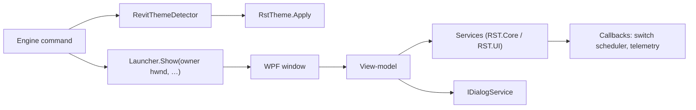

# Developing rst-c

Notes for working on rst-c itself: the native WPF front end (feature #14, spec #16), the
shared family UI kit and its theme keys, the rules every window follows, the screenshot
pipeline, and notes per window.

## Architecture

rst-c's three windows (the Profile Loader, the Profile Builder and Health) are native WPF,
inside Revit's process, on the theme rst-c shares with gantt-it and splash-it.



| Project | Holds | Tests |
|---|---|---|
| `RST.Core` | The palette (`Theming/UiPalette`) and every rule with no WPF dependency: the Loader services and rules (`RST.Core.Loader`), the Builder's catalogue, drops, icon picker, editing and save rules (`RST.Core.Builder`), Health severity, formatters and chart maths (`RST.Core.Health`) | `RST.Tests`, on Linux and Windows |
| `RST.UI` | The vendored kit, the windows, their view-models, the shared controls (`RibbonPreview`, `ActivityChart`, `IconPicker`), and the services that need WPF, dialogs or the file system (logo resize, Health scan and clean). **Revit-free** | `RST.RuntimeTests`, Windows only |
| `RST.Engine` | The ribbon commands, `RevitThemeDetector`, the ribbon builder | Integration runner (VM) |

- **Commands → launchers.** `LoaderCommand`, `BuilderCommand` and `HealthCommand` first capture
  what the window needs from Revit (the command catalogue, the ribbon's tab titles, the profile
  switch scheduler, the Health context), then call `RevitThemeDetector.ApplyToWindows()` and the
  window's launcher: `ProfileLoaderLauncher.Show(owner, …)`, `ProfileBuilderLauncher.Show(owner, …)`
  or `HealthLauncher.Show(owner, …)`, with `owner` = `UIApplication.MainWindowHandle`. The launcher
  builds the services, the view-model and the window, owns it to Revit and calls `ShowDialog()`.
- **Revit is reached only through callbacks** (`IProfileSwitchScheduler`, the telemetry toggle,
  the captured context), so RST.UI never references Revit. `UiProjectTests` fails if RST.UI
  references RevitAPI, RevitAPIUI, Autodesk.*, AdWindows or RST.Engine.
- **MVVM without a package:** the kit's `ObservableObject` and `RelayCommand`. View-models take
  their backend interface (`IProfileLoaderBackend`, `IProfileBuilderBackend`, the Health service)
  and `IDialogService` through the constructor, so tests drive them with fakes.
- **Services in Core.** Whatever can be plain C# lives in RST.Core and is tested on Linux:
  the rules ported from the v2.x pages (see [History](#history-v2x-to-v30)) and the services that
  read and write `%AppData%\RST\` (`ProfileLibraryService`, `ProfileLoadService`,
  `LoaderPrefsService`, `AddinMaintenanceService`, `ProfileSaveService`, …). The WPF Loader and
  Builder share one copy of each.

## Vendoring policy (the family kit)

rst-c, [gantt-it](https://github.com/jedbjorn/gantt-it) and
[splash-it](https://github.com/jedbjorn/splash-it) are one family of Revit add-ins (MIT,
same owner). rst-c's WPF windows use the same kit. It is **vendored**: the files are
copied into this repo, with no shared package. Splash-it vendored it from gantt-it first,
so rst-c copies from splash-it.

- **Source commits:** splash-it `ba86a71`, and gantt-it `a96d0a1` for the original files
  (the kit files did not change in gantt-it between `aa83f35` and `a96d0a1`).
- **Provenance header:** every copied or adapted file starts with one, for example:

  ```text
  // Copied from splash-it src/SplashIt.UI/Theming/ThemePalette.cs (splash-it commit ba86a71;
  // originally gantt-it src/GanttIt.Revit/UI/Theming/ThemePalette.cs, gantt-it commit a96d0a1), MIT, same owner.
  // Changes: namespaces (SplashIt.* to RST.*); reads RstTheme where splash-it reads SplashItTheme.
  ```

  The header says **Adapted from** when the behavior changed. XAML and `.resx` files
  carry the same text in a `<!-- -->` comment. rst-c's own new files say
  `rst-c's own (not vendored)` instead.
- **Renames:** `SplashIt.*` became `RST.*` (`RST.Core.Theming`, `RST.UI.Theming`, …).
  `SplashItTheme` became `RstTheme`. The env vars are `RST_THEME` (Debug builds only:
  forces the detected theme) and `RST_SCREENSHOTS`. The kit's `Trace` calls became
  Serilog `Log`.
- **To update the kit:** re-copy from the sister repo's `origin/main`. Update the commit
  in each header, then re-apply the `Changes:` line. Do not edit the sister repos from
  here.

| Where | What |
|---|---|
| `src/RST.Core/Theming/UiPalette.cs` | the light and dark palettes, plus the WCAG `Requirements` |
| `src/RST.Core/Colors/`, `Picking/` | `Rgb`, `RecentColors`, `ScreenSampling` (for the color picker) |
| `src/RST.Tests/Theming/`, `Picking/`, `Colors/` | `UiPaletteTests` (scans `src/RST.UI/**/*.xaml`, finds the repo by `RST-C.sln`), plus the sampling and recent-colors tests |
| `src/RST.UI/Theme.xaml` | the theme. Each window merges `/RST.UI;component/Theme.xaml` |
| `src/RST.UI/Theming/` | `ThemePalette`, `DarkTitleBar`, `RstTheme` |
| `src/RST.UI/Mvvm/` | `ObservableObject`, `RelayCommand`, the converters, `Behaviors` (`HasError`, `CommitOnEnter`) |
| `src/RST.UI/Dialogs/` | `IDialogService`/`DialogService`, `MessageDialog`, `MonitorWorkArea`, `NativeColorDialog`, and rst-c's `WindowPlacement` |
| `src/RST.UI/Swatches/` | `ColorPicker`, `ColorPickerDialog`, the eyedropper (`ScreenColorPicker`, `ScreenPickOverlay`, `NativeScreen`) |
| `src/RST.UI/Resources/UiStrings.*` | English strings, used as `{x:Static res:UiStrings.Key}` |
| `src/RST.UI/Controls/` | rst-c's own: `TransientMessage`, `BusyState`, `CardState` |
| `src/RST.Engine/Theming/RevitThemeDetector.cs` | reads Revit's theme. `ApplyToWindows()` = `RstTheme.Apply(Detect())` |

**RST.UI stays Revit-free.** `UiProjectTests` fails if RST.UI references RevitAPI,
RevitAPIUI, Autodesk.*, AdWindows or RST.Engine.

## Window rules

Every rst-c window and dialog follows these. Copy them into a new window.

### Opening

```csharp
RevitThemeDetector.ApplyToWindows();               // Engine: before the window is built
var dialogs = new DialogService();
var window = new ProfileLoaderWindow(new ProfileLoaderViewModel(..., dialogs));
dialogs.Owner = window;
WindowPlacement.Own(window, commandData.Application.MainWindowHandle);
window.ShowDialog();
```

In practice the launcher does all but the first line. Each window:

- merges Theme.xaml;
- calls `DarkTitleBar.Attach(this)` in its constructor;
- calls `WindowPlacement.CapToWorkArea(this)` from `OnSourceInitialized`;
- uses `Background="{DynamicResource WindowBrush}"`, `FontFamily="Segoe UI"`, `FontSize="12"`,
  `UseLayoutRounding="True"` and `TextOptions.TextFormattingMode="Display"`;
- sets `ShowInTaskbar="False"` and `WindowStartupLocation="CenterOwner"`.

### Theme

`RevitThemeDetector.Detect()` reads Revit's UI theme (`UIThemeManager`, including "Use system
setting") and `RstTheme.Apply` pushes it into the kit before the window is built. Theme.xaml reads
the palette when it loads, so **a window keeps the theme it opened with**; there is no live
re-theme (the family behaves the same way). The shared `RibbonPreview` canvas follows that theme
too. In Debug builds, `RST_THEME=dark|light` forces a theme for quick captures. A failed read
falls back to light.

### Owner, placement and the taskbar

- **`WindowPlacement.Own(window, hwnd)`** sets the Win32 owner to Revit's main window and
  `CenterOwner`. A zero handle (tests, an odd host) leaves the window unowned and `CenterScreen`.
- **`WindowPlacement.CapToWorkArea(window)`** keeps the window inside the monitor's work area
  (sizes as in v2.x: 1450 × 900 for the Loader and Builder, 900 × 800 for Health), so on a short
  screen the content scrolls and the title bar and buttons stay reachable.
- **`ShowInTaskbar="False"`** on every `Window`, dialogs included. An owned window still gets its
  own taskbar entry (grouped under Revit) unless this is set; the VM found that on the first Health
  build. The runtime tests assert it per window: `LoaderTaskbarTests`, `HealthWindowScreenshotTests`,
  `ProfileBuilderScreenshotTests` and `ProfileBuilderInteractionScreenshotTests`.

### Behavior

- **Modal**, as in v2.x: one rst-c window at a time; Revit waits.
- **Long work off the UI thread** (Scan System, Clean Junk Files, the load's add-in renames), with
  the busy overlay or spinner shown and the commands disabled until it finishes.
- **Destructive confirms default to Cancel** (`IDialogService.Confirm(..., danger: true)`); so does
  Confirm Add-in Changes.
- **External links** open with `Process.Start` and `UseShellExecute`, and only for absolute
  `http`/`https` URLs: a shared profile is untrusted input.
- **Closing or rebuilding a bound list from inside a WPF event** (the window's `Closing`, a
  ComboBox's selection write) is posted to run after the event (`ProfileBuilderViewModel`'s
  `post`). Doing it inline re-enters WPF mid-event. `ProfileBuilderWindowFlowTests` drives a real
  window to cover it.

### Drag and drop, and the TextBox preview routing lesson

The Builder's drag and drop (`ProfileBuilderWindow.xaml.cs`, rules in `RST.Core.Builder.PanelDrops`):

- `DragDrop.DoDragDrop` with a typed payload (`BuilderDrag`: catalogue row, panel header, slot row),
  never text, so nothing outside rst-c accepts it.
- The cards and rows report which half the cursor is over; the view-model sets `DropMarker` on the
  target, drawn as an overlay border, so the layout never shifts (gantt-it's row-border approach).
- **A `TextBox` swallows drags.** Its `TextEditor` marks `DragOver` and `Drop` handled (with no
  effect) for any non-text payload, so a row's bubbling handlers never run over its name box,
  which covers most of the row (VM defect D1). The fix is to handle the **preview** events on the
  boxes (`PreviewDragEnter`, `PreviewDragOver`, `PreviewDrop`): when
  `e.Data.GetDataPresent(typeof(BuilderDrag))`, forward to the row or card under it and mark the
  event handled; otherwise leave it, so a text drag still reaches the TextBox.
- **Starting a drag:** `PreviewMouseLeftButtonDown` remembers a pending drag unless the press is
  inside a `TextBoxBase` or `ButtonBase` (`IsInteractive`), so typing, selecting text and clicking
  ▲ ▼ × never start one.

### Popups

The Branding popover is a `StaysOpen="False"` `Popup` opened by a `ToggleButton` bound to
`IsOpen`, and the toggle is not hit-testable while the popup is open. Otherwise the click that
dismisses the popup reaches the button and reopens it (VM defect D2). On `Opened`, keyboard focus
moves into the popup (its first control), because a mouse click leaves focus in the window and
Escape would never reach the popup's key handler.

## Theme keys

The kit's keys are unchanged from splash-it. The kit's styles:

- **Implicit:** Button, ContextMenu, MenuItem, TextBox, ComboBox, CheckBox, ListBox,
  ToolTip, ScrollBar, Slider.
- **Keyed:** `HeadingText`, `SectionText`, `LabelText`, `MutedText`, `ErrorText`,
  `ColumnHeaderText`, `FocusRing`, `PrimaryButton`, `DangerButton`, `DangerFilledButton`,
  `IconButton`, `Panel`, `InfoBanner`, `WarningBanner`, `ErrorBanner`, `TextBoxContextMenu`,
  `IconFont`.
- **Converters:** `BoolToVisible`, `BoolToCollapsed`, `NullToCollapsed`, `InverseBool`,
  `DoubleToGridLength`.

rst-c adds the following. Every pairing they draw is a `ContrastRequirement` in
`UiPalette.RstRequirements`, checked by `UiPaletteTests`.

### New palette brushes

| Key | Purpose |
|---|---|
| `SuccessBrush` | Success text and strokes: the "● Loaded" badge, the active card's border, the success pill's text |
| `SuccessSoftBrush` | Success fill behind text: the success banner, toast and pill |
| `SuccessBorderBrush` | The success banner's and pill's outline (decorative) |
| `ScrimBrush` | The translucent wash behind the busy overlay (decorative; never under text) |

### New styles and resources

| Key | Target | Purpose |
|---|---|---|
| `SuccessText` | TextBlock | Success-colored text ("● Loaded") |
| `SuccessBanner` | Border | A success banner, alongside the kit's Info/Warning/Error banners |
| `Pill` | ContentControl | A neutral rounded label: counts (Profiles count, tree match counts), the "Native" status. Usage: `<ContentControl Style="{StaticResource Pill}" Content="12" />` |
| `InfoPill` / `SuccessPill` / `WarningPill` / `ErrorPill` | ContentControl | Status pills (Installed / Loaded / Disabled / Not Found) |
| `ToggleSwitch` | CheckBox | The rst-toggle switch. Filled with the check-box accent when on; off is an outlined track. Disabled is drawn at 45 % opacity |
| *(implicit)* | TabControl, TabItem | A flat header strip over a divider. The selected tab shows body text and a 2 px accent underline. Top placement only |
| `TreeExpander` | ToggleButton | The tree's chevron, used by the implicit TreeViewItem |
| *(implicit)* | TreeView, TreeViewItem | Virtualizing (recycling, pixel scroll). Hover and selected rows (AccentSoft). Headers stretch, so a header template can dock a `Pill` count to the right |
| *(implicit)* | ListBoxItem | Plain list rows: hover, and selected (AccentSoft), instead of the Windows system blue |
| `CardListBox` | ListBox | A transparent, borderless card list with no horizontal scroll that uses `CardListBoxItem` |
| `CardListBoxItem` | ListBoxItem | A selectable card. Normal: 1 px border. Hover: hover fill and strong border. Selected: 2 px accent ring. Active (`controls:CardState.IsActive="True"`): 2 px success ring, which wins over selected |
| `VerticalGridSplitter` / `HorizontalGridSplitter` | GridSplitter | A 7 px grab strip with a 1 px divider line. The line turns strong-border under the pointer and accent while dragging. Put the splitter in its own column or row |
| `BusyIndicator` | ProgressBar | An indeterminate thin bar with a sliding accent segment |
| `BusySpinner` | ProgressBar | A 16 px turning accent arc. Inside a `PrimaryButton`, set `Foreground="{StaticResource OnAccentBrush}"` |
| `BusyOverlay` | ContentControl | The `RSTmsgWait` overlay. Content: a `BusyState`. A scrim, then a centred panel with the spinner, `Title` and `Message`. Put it last in the root grid, spanning everything. The view-model also disables its commands while busy |
| `TransientBanner` | ContentControl | The `RSTmsgInform` / `showToast` toast. Content: a `TransientMessage`. Info/Success/Warning/Error colors by `Kind`, an optional bold `Title`, top-centre, click-through. Put it last in the root grid |

### Models (RST.UI.Controls)

- `TransientMessage.Show(text, kind, duration, title)`. The default duration is
  `InformDuration` (3 s). Pass `ToastDuration` (2.4 s) for the Builder toasts. A new
  `Show` replaces the message and restarts the timer. Tests pass a fake scheduler.
- `BusyState.Show(title, message)` and `Hide()`.
- `CardState.IsActive`, an attached property for the card's active state.

## Runtime tests and screenshots

`src/RST.RuntimeTests` holds the WPF tests. They need Windows but not Revit, so they run
in CI only. Locally, build them with `-p:EnableWindowsTargeting=true`.

- **Support:**
  - `Support/Screenshots`: `RunSta`, `Render`, `Save` to
    `<repo>/TestResults/screenshots/<name>.png` (or `$RST_SCREENSHOTS`), `PixelAt`,
    `DistinctPixels`.
  - `Support/WindowCapture`: `ShowOffScreen` (shows the window at -32000, not activated),
    `Client` (the client area only, without the DWM title bar), and **`Content`**.
    `Content(window, size)` renders the window's content at a chosen size without clipping
    it to the window. The CI desktop is about 1024 × 768, and Windows caps a window at the
    desktop size, so use `Content` for the 1450 × 900 Loader and Builder. The content must
    paint its own `WindowBrush` background. The gallery run writes
    `capture-environment.txt` with the CI screen size.
  - `Support/Fakes`: `FakeDialogs`, a scripted `IDialogService`, and `TempFolder`.
- **Theme:** call `RstTheme.Apply(theme)` before building a window. Window tests use the
  `WpfThemeCollection`, which runs them one at a time because the theme is process-wide.
  Name the files `<what>-light|dark`.
- **The tests:**
  - `Gallery/StyleGalleryScreenshotTests`: `style-gallery-light|dark`, every style with the
    real confirm dialog drawn in; `message-dialog-confirm|message-light|dark`; and
    `color-picker-dialog-light|dark`. Each run also samples the pixels of the new styles'
    states.
  - `ScreenshotPipelineTests`: `smoke-palette`.
  - `UiProjectTests` and `UiStringsTests`.
  - `Bootstrap/EngineDependencyResolverTests`: every branch of the bootstrap's assembly
    resolver (see [The bootstrap's assembly resolver](#the-bootstraps-assembly-resolver)).

To get the screenshots from CI, open the PR's run. The `Test (runtime, Windows)` job uploads
the artifact **`RST-screenshots`**, which holds every PNG and `capture-environment.txt`. It
is uploaded even when a test fails. If that job runs as a per-major matrix, only the R25 leg
uploads. Download it with:

```sh
gh run download <run-id> -n RST-screenshots -D <folder>
```

## The Health window (WU2)

The Health window (`src/RST.UI/Health/HealthWindow.xaml`, view-model `HealthViewModel`) adds:

| Key | Target | Purpose |
|---|---|---|
| `CautionTextBrush` | palette | The soft-warning severity (the HTML's warn-soft), between OK (`SuccessBrush`) and `WarningTextBrush`. Checked by `UiPalette.HealthRequirements` |
| `SectionExpander` | Expander | A collapsible bordered section: the header (`HeaderTemplate`) with a chevron on the right that turns down when open, then a divider and the body. Collapsed unless `IsExpanded` |
| `SectionExpanderHeader` | ToggleButton | The expander's header row (used by `SectionExpander`) |
| `RangePillGroup` / `RangePill` | Border / RadioButton | A segmented toggle: an outlined track of `RadioButton` pills (one `GroupName` per group); the checked pill is accent-tinted and outlined |

- **Severity colors:** `HealthBrushes.KeyFor(severity, fallback)` maps OK, WarnSoft, Warn, Danger and Info to
  `SuccessBrush`, `CautionTextBrush`, `WarningTextBrush`, `ErrorBrush` and `AccentForegroundBrush`.
- **`controls:ActivityChart`** draws an `RST.Core.Health.ActivityChartLayout` (760 × 190 logical, scaled to its
  width): gridlines with y labels, date ticks, the monotone curve as a `Path` of `BezierSegment`s and dots with
  tooltips. Set `LineBrush`, `GridBrush`, `LabelBrush` and `DotStrokeBrush`.
- **RST.Core** holds the rules: `HealthSeverityRules`, `HealthFormat` (`fmt`, `fmtDur`, `fmtHoursShort`,
  `fmtElapsed`, and `HoursAxis`/`DurAxis`, which keep the four gridline labels distinct for small values), `ActivityChartMath` (Fritsch–Carlson tangents, the curve, `chartMode`), `ActivityChartLayout`,
  `ActivityStats` (`activityStatValues`) and `ActivityRanges`. `tests/ui/activity-chart.test.mjs` is ported to
  `src/RST.Tests/Health/`.
- **Opening it:** `HealthLauncher.Show(ownerHwnd, context, telemetryToggled, liveSessionStartUtc)`, after
  `RevitThemeDetector.ApplyToWindows()`. Scan and Clean run off the UI thread (`HealthViewModelOptions.RunInBackground`);
  while either runs, every command and input is disabled.
- **Screenshots** (`src/RST.RuntimeTests/Health/HealthWindowScreenshotTests`): `health-sections`, `health-empty`,
  `health-scanning`, `junk-modal`, `junk-modal-empty`, `health-cleaning`, `cleanup-result`, `activity-curves`, `activity-small`
  and `activity-sparse`, each `-light` and `-dark`. The sections and curve captures are 900 wide and as tall as
  their content (the real window, 800 tall, scrolls); the others are 900 × 800.

## The Profile Loader (WU3)

- **Logic in RST.Core (`RST.Core.Loader`, tested on Linux in `RST.Tests/Loader`):** the ported
  JS rules (`RequiredAddinRules`, `RstifyRules`, `FailedDisableMessages`, `RibbonPreviewRules`)
  and the Loader services (`ProfileLibraryService`,
  `ProfileLoadService`, `LoaderPrefsService`, `AddinMaintenanceService`, `AddinLookupService`). The
  WPF Builder's backend calls the same services for its profile list, the active profile, the
  auto-reload and the add-in lookup. The services log through `ILoaderLog` (Serilog in RST.UI).
- **The window (`RST.UI/Loader`):** `ProfileLoaderLauncher.Show(owner, …)` →
  `ProfileLoaderWindow` → `ProfileLoaderViewModel`, which talks to `IProfileLoaderBackend` (the
  services) and `ILoaderDialogs` (`ConfirmAddinChangesWindow`, `AddinCheckWindow`). The load's
  add-in renames run on the thread pool (`ProfileLoadService.Begin` / `RunAddinPasses` / `Finish`).
- **`RibbonPreview` (`RST.UI/Controls`):** the shared preview. Set `Profile`, optionally
  `OverrideOpacity`, `Mode` (`Loader` or `Builder`: tool labels by name, "(empty)" stacks,
  "No panels configured.") and `TopBarContent`; bump `Revision` or call `Refresh()` after editing
  the profile in place.
- **Theme.xaml "Loader" block:** `LoaderLink` (Hyperlink: accent text, underlined on hover; its
  contrast is in `UiPalette.Requirements`), `LoaderStrip` (header and footer strips), `LoaderRow`
  (list rows with a divider).
- **Tests:** `RST.RuntimeTests/Loader` (view-model flows with fakes, screenshots `loader-*`, and
  AC6 over the v2.2.0 fixtures in `src/RST.Tests/Fixtures/V220`).

## The Profile Builder (WU4, WU5)

The Profile Builder lives in `RST.UI/Builder`. `BuilderCommand` applies Revit's theme and calls
`ProfileBuilderLauncher.Show(MainWindowHandle, …)`.

- **Logic in RST.Core (`RST.Core.Builder`, tested on Linux in `RST.Tests/Builder`):**
  `CatalogCommand` (get_catalog's shape and host-tab promotion), `CatalogTree` (the catalogue index
  and filter: built once, a filter only computes per-node match counts), `RequiredAddinDetector`
  (computeRequiredAddins, the port of `tests/ui/required-addins.test.mjs` is
  `RequiredAddinDetectorTests`), `BuilderRules` (shortId, normalizeUrl via `UrlNormalizer`,
  normalizeHex, the slot shapes and summaries), `ProfileEditing` (startFresh, loadIntoProfile, the
  dirty snapshot, rename-as-copy) and `ProfileSaveService` (save_profile and export_profile's writes).
- **The window:** `ProfileBuilderWindow` → `ProfileBuilderViewModel`, which talks to
  `IProfileBuilderBackend` and `IDialogService`. The catalogue tree is a virtualizing `TreeView`
  over `CatalogNodeViewModel`s built once; a filter updates counts and each node's
  `FilteredCollection` of visible children (small changes item by item, big ones as one Reset).
  Panel and slot edits write straight into the profile and bump `PreviewRevision`, which redraws
  the shared `RibbonPreview` (Builder mode).
- **Dialogs:** `IDialogService.Choose` is the three-way prompt (MessageDialog's optional
  `SecondaryText` button) used for Save & Exit / Discard & Exit / Cancel. Every Builder window and
  dialog sets `ShowInTaskbar="False"`.
- **Tests:** `RST.RuntimeTests/Builder`: view-model flows with fakes, screenshots `builder-*`,
  AC6 (`ProfileBuilderDataCompatibilityTests`, over the v2.2.0 fixtures and the captured v2.2.0 save
  payloads in `src/RST.Tests/Fixtures/V220/builder`), and AC7 (`ProfileBuilderPerformanceTests`: 823
  commands, median keystroke under 100 ms, and far fewer realized rows than commands).
- **WU5 additions:**
  - **Drag and drop:** `RST.Core.Builder.PanelDrops` holds the index arithmetic and the
    marker rules; see [Drag and drop](#drag-and-drop-and-the-textbox-preview-routing-lesson) for
    the window side.
  - **Icon picker:** `RST.Core.Builder.IconPickerModel` (the port of `icon-picker.test.mjs`'s
    behavior, as a row model), `Controls/IconPickerViewModel` and the `Controls/IconPicker` overlay
    (a scrim inside the Builder window, so a click outside the card cancels).
  - **Modals:** `PresetsWindow` and `CleanupWindow` (family dialogs, `ShowInTaskbar="False"`) over
    `PresetsViewModel` / `CleanupViewModel`, behind `IBuilderDialogs`. The Cleanup modal edits a copy.
  - **Branding popover:** see [Popups](#popups).

## Revit API floor

rst-c supports every update of Revit 2025, 2026 and 2027 (decision #26). Revit 2025 is
partially supported: it is assumed to behave like 2026, takes the same code paths, and is
verified by hand after a public release because the test machine has no 2025 (decision #21).

Every project compiles against each year's **earliest** update, so the compiler refuses any
API that a later update added. A user on that first update would otherwise get a
`TypeLoadException` or `MissingMethodException` the first time the code ran.

| Revit year | Nice3point.Revit.Api pin | RevitAPI assembly |
|---|---|---|
| 2025 | `2025.0.2` | 25.0.0.0 |
| 2026 | `2026.0.4` | 26.0.4.0 |
| 2027 | `2027.0.0` | 27.0.0.0 |

The pins are inline in `src/RST.Engine/RST.Engine.csproj` and `src/RST.Bootstrap/RST.Bootstrap.csproj`
(RevitAPI, RevitAPIUI and, in the engine, AdWindows), and in the test add-ins under
`tests/fixtures/`. Each item sets both `Version` and `VersionOverride`. The `Test (xunit)` CI job
runs `build/check-revit-api-floor.py` first. It reads every tracked `.csproj`, `.props` and
`.targets` file and fails on any `Nice3point.Revit.Api.*` version above the floor, on an item
with no version, and on a Revit year that has no floor.

**Raising the floor on purpose.** Do it only when a feature needs API from a later update, and
accept that users on the older updates of that year lose support.

1. Pick the earliest update that has the API, and check that its Nice3point package exists.
2. Change `Version` and `VersionOverride` for that year in every project that pins it
   (`grep -rn "Nice3point.Revit.Api" --include=*.csproj --include=*.props .`).
3. Change that year's entry in `FLOOR` in `build/check-revit-api-floor.py`.
4. Build Debug and Release for that year, and update the table above and the README's
   Compatibility section.
5. Record the change as a decision and in the release notes ("drops Revit 2026.0 to 2026.2").

A new Revit year needs a `FLOOR` entry too. Until it has one, the check fails.

### The journal's version-conflict notice

Revit writes `API_ERROR { : Assembly version conflict in some references in RST.Bootstrap.dll
assembly` to its journal at every start. The lines that follow name RevitAPI and RevitAPIUI, for
example `Addin's module RevitAPI of version 26.0.4.0 conflicts with same preloaded module of
version 26.4.10.0`. Revit logs this for every add-in, Autodesk's own included, whenever the
add-in's reference differs from the assembly Revit has loaded, and then loads the add-in
normally. Because of the floor, our reference is always lower than or equal to the loaded
version, which is harmless. Treat the notice as a problem only when the **add-in's version is
higher than the preloaded one**: then the add-in uses API or a dependency newer than the
running Revit has, and it fails at run time. When you read a journal in evidence, extract the
whole block, not its first line:
`[regex]::Matches((Get-Content $j -Raw), "API_ERROR \{ : Assembly version conflict[^}]*\}")`.

## The bootstrap's assembly resolver

`RST.Bootstrap` loads the engine into Revit's shared default load context and registers a
process-wide `AssemblyLoadContext.Default.Resolving` handler over `RST.Engine.deps.json`. Any
add-in's request for Serilog, Serilog.Sinks.File, System.Management, RST.Core or RST.UI can reach
it. `EngineDependencyResolver` (in `RstBootstrap.cs`, decision #27):

- returns `null` when the requested version is above the copy RST ships, so it never hands
  another add-in an older copy than it asked for;
- returns an already-loaded assembly of the same name when its version is at or above the request,
  instead of loading ours by path;
- otherwise, when an older copy is already loaded, writes a `WRN` line to the boot log naming
  both versions and the loaded path, and returns `null`;
- never throws from inside the event: a failure becomes a `WRN` line and `null`.

After the engine's `OnStartup`, the boot log records the Serilog the engine bound to:
`Serilog bound: 4.0.0.0 at <path> (engine compiled against 4.0.0.0)`. That line is a `WRN` when
Serilog is older than compiled, which means another add-in's resolver supplied its copy first.
The handler cannot prevent that. Only one Serilog can load into the shared context, so when
another add-in loads a different version first, one of the two add-ins loses. RST still shares
Serilog's global `Log.Logger`; moving to a private logger is planned for v3.1.

## History (v2.x to v3.0)

Up to v2.2.0 the three windows were HTML pages in WebView2: `profile_loader.html`,
`profile_builder.html` and `health_viewer.html` under `src/RST.UI/Assets/`, behind `LoaderWindow`,
`LoaderHost`, `LoaderBridge`, `HealthHost`, `HealthBridge` and `FileDialogBridge`, with
`pywebview-shim.js`, `rst_messages.js` and `rst_components.css`. Feature #14 replaced them one for
one and removed the WebView2 package and its DLLs from the MSI. rst-c no longer creates
`%LocalAppData%\RST\WebView2`; an existing folder is left in place on users' machines.

Comments in the ported code cite those files with line numbers (for example
`profile_builder.html 2346-2376`, or `LB:509-620` for `LoaderBridge.cs`). They refer to v2.2.0;
read them with `git show v2.2.0:src/RST.UI/Assets/profile_builder.html` or
`git show v2.2.0:src/RST.UI/Loader/LoaderBridge.cs`. The v2.2.0 reference data the AC6 tests
compare against is in `src/RST.Tests/Fixtures/V220`.
