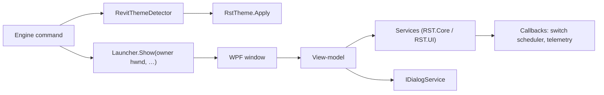

# Developing rst-c

Notes for working on rst-c itself: the native WPF front end (feature #14, spec #16), the
shared family UI kit and its theme keys, the rules every window follows, the screenshot
pipeline, and notes per window.

## Architecture

rst-c's three windows (the Profile Loader, the Profile Builder and Health) are native WPF,
inside Revit's process, on the theme rst-c shares with gantt-it and splash-it.



| Project | Holds | Tests |
|---|---|---|
| `RST.Core` | The palette (`Theming/UiPalette`) and every rule with no WPF dependency: the Loader services and rules (`RST.Core.Loader`), the Builder's catalogue, drops, icon picker, editing and save rules (`RST.Core.Builder`), Health severity, formatters and chart maths (`RST.Core.Health`) | `RST.Tests`, on Linux and Windows |
| `RST.UI` | The vendored kit, the windows, their view-models, the shared controls (`RibbonPreview`, `ActivityChart`, `IconPicker`), and the services that need WPF, dialogs or the file system (logo resize, Health scan and clean). **Revit-free** | `RST.RuntimeTests`, Windows only |
| `RST.Engine` | The ribbon commands, `RevitThemeDetector`, the ribbon builder | Integration runner (VM); the profile tab's AdWindows mapping also in `RST.RuntimeTests` (see [Ribbon stacks](#ribbon-stacks-f15)) |

- **Commands → launchers.** `LoaderCommand`, `BuilderCommand` and `HealthCommand` first capture
  what the window needs from Revit (the command catalogue, the ribbon's tab titles, the profile
  switch scheduler, the Health context), then call `RevitThemeDetector.ApplyToWindows()` and the
  window's launcher: `ProfileLoaderLauncher.Show(owner, …)`, `ProfileBuilderLauncher.Show(owner, …)`
  or `HealthLauncher.Show(owner, …)`, with `owner` = `UIApplication.MainWindowHandle`. The launcher
  builds the services, the view-model and the window, owns it to Revit and calls `ShowDialog()`.
- **Revit is reached only through callbacks** (`IProfileSwitchScheduler`, the telemetry toggle,
  the captured context), so RST.UI never references Revit. `UiProjectTests` fails if RST.UI
  references RevitAPI, RevitAPIUI, Autodesk.*, AdWindows or RST.Engine.
- **MVVM without a package:** the kit's `ObservableObject` and `RelayCommand`. View-models take
  their backend interface (`IProfileLoaderBackend`, `IProfileBuilderBackend`, the Health service)
  and `IDialogService` through the constructor, so tests drive them with fakes.
- **Services in Core.** Whatever can be plain C# lives in RST.Core and is tested on Linux:
  the rules ported from the v2.x pages (see [History](#history-v2x-to-v30)) and the services that
  read and write `%AppData%\RST\` (`ProfileLibraryService`, `ProfileLoadService`,
  `LoaderPrefsService`, `AddinMaintenanceService`, `ProfileSaveService`, …). The WPF Loader and
  Builder share one copy of each.

## Vendoring policy (the family kit)

rst-c, [gantt-it](https://github.com/jedbjorn/gantt-it) and
[splash-it](https://github.com/jedbjorn/splash-it) are one family of Revit add-ins (MIT,
same owner). rst-c's WPF windows use the same kit. It is **vendored**: the files are
copied into this repo, with no shared package. Splash-it vendored it from gantt-it first,
so rst-c copies from splash-it.

- **Source commits:** splash-it `ba86a71`, and gantt-it `a96d0a1` for the original files
  (the kit files did not change in gantt-it between `aa83f35` and `a96d0a1`).
- **Provenance header:** every copied or adapted file starts with one, for example:

  ```text
  // Copied from splash-it src/SplashIt.UI/Theming/ThemePalette.cs (splash-it commit ba86a71;
  // originally gantt-it src/GanttIt.Revit/UI/Theming/ThemePalette.cs, gantt-it commit a96d0a1), MIT, same owner.
  // Changes: namespaces (SplashIt.* to RST.*); reads RstTheme where splash-it reads SplashItTheme.
  ```

  The header says **Adapted from** when the behavior changed. XAML and `.resx` files
  carry the same text in a `<!-- -->` comment. rst-c's own new files say
  `rst-c's own (not vendored)` instead.
- **Renames:** `SplashIt.*` became `RST.*` (`RST.Core.Theming`, `RST.UI.Theming`, …).
  `SplashItTheme` became `RstTheme`. The env vars are `RST_THEME` (Debug builds only:
  forces the detected theme) and `RST_SCREENSHOTS`. The kit's `Trace` calls became
  `Log` (RST.Core.Logging, rst-c's logger).
- **To update the kit:** re-copy from the sister repo's `origin/main`. Update the commit
  in each header, then re-apply the `Changes:` line. Do not edit the sister repos from
  here.

| Where | What |
|---|---|
| `src/RST.Core/Theming/UiPalette.cs` | the light and dark palettes, plus the WCAG `Requirements` |
| `src/RST.Core/Colors/`, `Picking/` | `Rgb`, `RecentColors`, `ScreenSampling` (for the color picker) |
| `src/RST.Tests/Theming/`, `Picking/`, `Colors/` | `UiPaletteTests` (scans `src/RST.UI/**/*.xaml`, finds the repo by `RST-C.sln`), plus the sampling and recent-colors tests |
| `src/RST.UI/Theme.xaml` | the theme. Each window merges `/RST.UI;component/Theme.xaml` |
| `src/RST.UI/Theming/` | `ThemePalette`, `DarkTitleBar`, `RstTheme` |
| `src/RST.UI/Mvvm/` | `ObservableObject`, `RelayCommand`, the converters, `Behaviors` (`HasError`, `CommitOnEnter`) |
| `src/RST.UI/Dialogs/` | `IDialogService`/`DialogService`, `MessageDialog`, `MonitorWorkArea`, `NativeColorDialog`, and rst-c's `WindowPlacement` |
| `src/RST.UI/Swatches/` | `ColorPicker`, `ColorPickerDialog`, the eyedropper (`ScreenColorPicker`, `ScreenPickOverlay`, `NativeScreen`) |
| `src/RST.UI/Resources/UiStrings.*` | English strings, used as `{x:Static res:UiStrings.Key}` |
| `src/RST.UI/Controls/` | rst-c's own: `TransientMessage`, `BusyState`, `CardState` |
| `src/RST.Engine/Theming/RevitThemeDetector.cs` | reads Revit's theme. `ApplyToWindows()` = `RstTheme.Apply(Detect())` |

**RST.UI stays Revit-free.** `UiProjectTests` fails if RST.UI references RevitAPI,
RevitAPIUI, Autodesk.*, AdWindows or RST.Engine.

## Window rules

Every rst-c window and dialog follows these. Copy them into a new window.

### Opening

```csharp
RevitThemeDetector.ApplyToWindows();               // Engine: before the window is built
var dialogs = new DialogService();
var window = new ProfileLoaderWindow(new ProfileLoaderViewModel(..., dialogs));
dialogs.Owner = window;
WindowPlacement.Own(window, commandData.Application.MainWindowHandle);
window.ShowDialog();
```

In practice the launcher does all but the first line. Each window:

- merges Theme.xaml;
- calls `DarkTitleBar.Attach(this)` in its constructor;
- calls `WindowPlacement.CapToWorkArea(this)` from `OnSourceInitialized`;
- uses `Background="{DynamicResource WindowBrush}"`, `FontFamily="Segoe UI"`, `FontSize="12"`,
  `UseLayoutRounding="True"` and `TextOptions.TextFormattingMode="Display"`;
- sets `ShowInTaskbar="False"` and `WindowStartupLocation="CenterOwner"`.

### Theme

`RevitThemeDetector.Detect()` reads Revit's UI theme (`UIThemeManager`, including "Use system
setting") and `RstTheme.Apply` pushes it into the kit before the window is built. Theme.xaml reads
the palette when it loads, so **a window keeps the theme it opened with**; there is no live
re-theme (the family behaves the same way). The shared `RibbonPreview` canvas follows that theme
too. In Debug builds, `RST_THEME=dark|light` forces a theme for quick captures. A failed read
falls back to light.

### Owner, placement and the taskbar

- **`WindowPlacement.Own(window, hwnd)`** sets the Win32 owner to Revit's main window and
  `CenterOwner`. A zero handle (tests, an odd host) leaves the window unowned and `CenterScreen`.
- **`WindowPlacement.CapToWorkArea(window)`** keeps the window inside the monitor's work area
  (sizes as in v2.x: 1450 × 900 for the Loader and Builder, 900 × 800 for Health), so on a short
  screen the content scrolls and the title bar and buttons stay reachable.
- **`ShowInTaskbar="False"`** on every `Window`, dialogs included. An owned window still gets its
  own taskbar entry (grouped under Revit) unless this is set; the VM found that on the first Health
  build. The runtime tests assert it per window: `LoaderTaskbarTests`, `HealthWindowScreenshotTests`,
  `ProfileBuilderScreenshotTests` and `ProfileBuilderInteractionScreenshotTests`.

### Behavior

- **Modal**, as in v2.x: one rst-c window at a time; Revit waits.
- **Long work off the UI thread** (Scan System, Clean Junk Files, the load's add-in changes), with
  the busy overlay or spinner shown and the commands disabled until it finishes.
- **Destructive confirms default to Cancel** (`IDialogService.Confirm(..., danger: true)`); so does
  Confirm Add-in Changes.
- **External links** open with `Process.Start` and `UseShellExecute`, and only for absolute
  `http`/`https` URLs: a shared profile is untrusted input.
- **Closing or rebuilding a bound list from inside a WPF event** (the window's `Closing`, a
  ComboBox's selection write) is posted to run after the event (`ProfileBuilderViewModel`'s
  `post`). Doing it inline re-enters WPF mid-event. `ProfileBuilderWindowFlowTests` drives a real
  window to cover it.

### Drag and drop, and the TextBox preview routing lesson

The Builder's drag and drop (`ProfileBuilderWindow.xaml.cs`; rules in `RST.Core.Builder.TileDrops`
for tools and stacks, `PanelDrops` for the panel reorder, and `PanelStacks` for every model change):

- `DragDrop.DoDragDrop` with a typed payload (`BuilderDrag`: catalogue row, panel header, tile,
  stack row, stack header), never text, so nothing outside rst-c accepts it.
- Each card works out what is under the pointer: a tile, a stack group or a stack's row, and where
  on it (`TileHit`: across the tile or the whole stack; down the row). `TileDrops.Plan` turns that
  into the drop (feature #18, decisions #18 and #19): a tile's middle makes a stack, its leading or
  trailing quarter (at most 24 px) inserts before or after it; a stack row's upper or lower half
  joins the stack before or after that row; the stack's middle joins at the end; a full stack shows
  the refusal marker ("A stack holds 2–3 tools. This one is full."); a whole stack (dragged by its
  header) only ever goes beside, by the half it is over; the 10 px gutter after a tile or stack (its
  `TileCell`'s padding) counts as its nearer edge; the card outside the tiles appends. A tile, row or
  stack dropped where it already is gets no marker. The view-model sets `DropMarker` on the target,
  drawn as an overlay border (a left or right line on a tile, a top or bottom line on a row, a ring
  for a stack forming or joining, an error ring for a refusal), so the layout never shifts
  (gantt-it's row-border approach).
- **A refused drop still takes the drop.** OLE does not deliver `Drop` after a `None` effect, so a
  full stack answers `Move` (with the refusal marker) and the drop refuses it with a toast.
- **Identity:** a slot drag carries the slot it started from (`BuilderDrag.Source`) and each hit the
  slot the card showed (`TileHit.Expected`); `TileDrops.Plan` answers `Stale` when either moved, and
  ×, ✎ and un-stack check the card still matches the profile, so an edit made underneath (WU4's edit
  or remove everywhere) never lets an index hit another slot. A stale action is logged and the cards
  are redrawn.
- **A `TextBox` swallows drags.** Its `TextEditor` marks `DragOver` and `Drop` handled (with no
  effect) for any non-text payload, so bubbling handlers never run over a name box, and the name
  boxes cover much of each tile and row (VM defect D1). The fix is to handle the **preview** events
  (`PreviewDragEnter`, `PreviewDragOver`, `PreviewDrop`) before the TextBox sees them. Since WU3 the
  card does it for everything inside it: when `e.Data.GetDataPresent(typeof(BuilderDrag))`, the
  card's preview handler finds the tile or row under the pointer, reports it and marks the event
  handled; otherwise it leaves it, so a text drag still reaches the TextBox.
- **Starting a drag:** `PreviewMouseLeftButtonDown` remembers a pending drag unless the press is
  inside a `TextBoxBase` or a `ButtonBase` (`IsInteractive`), so typing, selecting text and
  clicking ✎, ×, ▲ or ▼ never start one. A tile's or a stack row's icon (`IconHandle`) is the
  exception: a press there arms a drag that starts once the pointer moves past
  `SystemParameters.MinimumHorizontal/VerticalDragDistance` (the button's mouse capture is released
  first, so no Click follows), and a still click opens the icon picker. The move is watched in the
  **Preview** phase (`PreviewMouseMove`): a button holding the mouse marks the bubbling `MouseMove`
  handled, so a bubbling handler on the tile or row would never see it. A tile's name box is only as
  wide as its text, a row's sits left, so the rest of each tile and row can be grabbed; the hover-only
  × takes no press while hidden (`IsHitTestVisible` follows the hover). The pointer, the button state
  and the OS drag loop are window seams (`PointerAt`, `LeftPressed`, `RunDragDrop`) so the runtime
  tests can drive the start gesture with real mouse events and no mouse (`ProfileBuilderDragStartTests`).
- **Focus selects the card:** focus entering a card (a name box, a button) selects it, so a
  double-click in Commands adds to the panel being edited.
- **Fresh slots:** the stack operations find slots by reference, so a catalogue drop or a
  double-click always places a new slot (`BuilderRules.ToolSlot`; WU1 review F3).

### Popups and menus

A button that opens a popup or a menu that closes on an outside click is a `ToggleButton`,
checked while it is open and not hit-testable then. Otherwise the click that dismisses the popup
reaches the button and reopens it (VM defect D2, found on v3.0's Branding popover). The Builder's
⚙ and profile buttons (feature #18) use the window's `MenuToggle` style: checking one opens its
`ContextMenu` under it (code-behind sets the menu's `DataContext` and `PlacementTarget`, since a
`ContextMenu` is not in the window's tree), and the menu's `Closed` unchecks it.

### Escape

Escape closes the Builder through the same path as Exit, so unsaved changes get the Save /
Discard / Cancel prompt (SC-010). The window acts only when nothing else has it: an open menu,
the icon picker overlay and the dialogs handle their own Escape (`ProfileBuilderWindow.OnKeyDown`).

## Theme keys

The kit's keys are unchanged from splash-it. The kit's styles:

- **Implicit:** Button, ContextMenu, MenuItem, TextBox, ComboBox, CheckBox, ListBox,
  ToolTip, ScrollBar, Slider.
- **Keyed:** `HeadingText`, `SectionText`, `LabelText`, `MutedText`, `ErrorText`,
  `ColumnHeaderText`, `FocusRing`, `PrimaryButton`, `DangerButton`, `DangerFilledButton`,
  `IconButton`, `Panel`, `InfoBanner`, `WarningBanner`, `ErrorBanner`, `TextBoxContextMenu`,
  `IconFont`.
- **Converters:** `BoolToVisible`, `BoolToCollapsed`, `NullToCollapsed`, `InverseBool`,
  `DoubleToGridLength`.

rst-c adds the following. Every pairing they draw is a `ContrastRequirement` in
`UiPalette.RstRequirements`, checked by `UiPaletteTests`.

### New palette brushes

| Key | Purpose |
|---|---|
| `SuccessBrush` | Success text and strokes: the "● Loaded" badge, the active card's border, the success pill's text |
| `SuccessSoftBrush` | Success fill behind text: the success banner, toast and pill |
| `SuccessBorderBrush` | The success banner's and pill's outline (decorative) |
| `ScrimBrush` | The translucent wash behind the busy overlay (decorative; never under text) |

### New styles and resources

| Key | Target | Purpose |
|---|---|---|
| `SuccessText` | TextBlock | Success-colored text ("● Loaded") |
| `SuccessBanner` | Border | A success banner, alongside the kit's Info/Warning/Error banners |
| `Pill` | ContentControl | A neutral rounded label: counts (Profiles count, tree match counts), the "Native" status. Usage: `<ContentControl Style="{StaticResource Pill}" Content="12" />` |
| `InfoPill` / `SuccessPill` / `WarningPill` / `ErrorPill` | ContentControl | Status pills (Installed / Loaded / Disabled / Not Found) |
| `ToggleSwitch` | CheckBox | The rst-toggle switch. Filled with the check-box accent when on; off is an outlined track. Disabled is drawn at 45 % opacity |
| *(implicit)* | TabControl, TabItem | A flat header strip over a divider. The selected tab shows body text and a 2 px accent underline. Top placement only |
| `TreeExpander` | ToggleButton | The tree's chevron, used by the implicit TreeViewItem |
| *(implicit)* | TreeView, TreeViewItem | Virtualizing (recycling, pixel scroll). Hover and selected rows (AccentSoft). Headers stretch, so a header template can dock a `Pill` count to the right |
| *(implicit)* | ListBoxItem | Plain list rows: hover, and selected (AccentSoft), instead of the Windows system blue |
| `CardListBox` | ListBox | A transparent, borderless card list with no horizontal scroll that uses `CardListBoxItem` |
| `CardListBoxItem` | ListBoxItem | A selectable card. Normal: 1 px border. Hover: hover fill and strong border. Selected: 2 px accent ring. Active (`controls:CardState.IsActive="True"`): 2 px success ring, which wins over selected |
| `VerticalGridSplitter` / `HorizontalGridSplitter` | GridSplitter | A 7 px grab strip with a 1 px divider line. The line turns strong-border under the pointer and accent while dragging. Put the splitter in its own column or row |
| `BusyIndicator` | ProgressBar | An indeterminate thin bar with a sliding accent segment |
| `BusySpinner` | ProgressBar | A 16 px turning accent arc. Inside a `PrimaryButton`, set `Foreground="{StaticResource OnAccentBrush}"` |
| `BusyOverlay` | ContentControl | The `RSTmsgWait` overlay. Content: a `BusyState`. A scrim, then a centred panel with the spinner, `Title` and `Message`. Put it last in the root grid, spanning everything. The view-model also disables its commands while busy |
| `TransientBanner` | ContentControl | The `RSTmsgInform` / `showToast` toast. Content: a `TransientMessage`. Info/Success/Warning/Error colors by `Kind`, an optional bold `Title`, top-centre, click-through. Put it last in the root grid |
| `HeaderStrip` | Border | A window's header (feature #18, decision #24): the Tint, `AccentSoftBrush` with an `InfoBorderBrush` bottom line, 54 px tall, 16 px side padding. The Builder's header; the Loader adopts it (F18 WU6). Its pairings are `UiPalette.HeaderRequirements` |
| `HeaderTitle` | TextBlock | The window title in a `HeaderStrip` ("Profile Builder"): `SectionText` at 14 px, vertically centred |
| `HeaderDivider` | Rectangle | The 1 × 20 px divider between header groups, 16 px each side |

### Models (RST.UI.Controls)

- `TransientMessage.Show(text, kind, duration, title)`. The default duration is
  `InformDuration` (3 s). Pass `ToastDuration` (2.4 s) for the Builder toasts. A new
  `Show` replaces the message and restarts the timer. Tests pass a fake scheduler.
- `BusyState.Show(title, message)` and `Hide()`.
- `CardState.IsActive`, an attached property for the card's active state.

## Runtime tests and screenshots

`src/RST.RuntimeTests` holds the WPF tests. They need Windows but not Revit, so they run
in CI only. Locally, build them with `-p:EnableWindowsTargeting=true`.

- **Support:**
  - `Support/Screenshots`: `RunSta`, `Render`, `Save` to
    `<repo>/TestResults/screenshots/<name>.png` (or `$RST_SCREENSHOTS`), `PixelAt`,
    `DistinctPixels`.
  - `Support/WindowCapture`: `ShowOffScreen` (shows the window at -32000, not activated),
    `Client` (the client area only, without the DWM title bar), and **`Content`**.
    `Content(window, size)` renders the window's content at a chosen size without clipping
    it to the window. The CI desktop is about 1024 × 768, and Windows caps a window at the
    desktop size, so use `Content` for the 1450 × 900 Loader and Builder. The content must
    paint its own `WindowBrush` background. The gallery run writes
    `capture-environment.txt` with the CI screen size.
  - `Support/Fakes`: `FakeDialogs`, a scripted `IDialogService`, and `TempFolder`.
- **Theme:** call `RstTheme.Apply(theme)` before building a window. Window tests use the
  `WpfThemeCollection`, which runs them one at a time because the theme is process-wide.
  Name the files `<what>-light|dark`.
- **The tests:**
  - `Gallery/StyleGalleryScreenshotTests`: `style-gallery-light|dark`, every style with the
    real confirm dialog drawn in; `message-dialog-confirm|message-light|dark`; and
    `color-picker-dialog-light|dark`. Each run also samples the pixels of the new styles'
    states.
  - `ScreenshotPipelineTests`: `smoke-palette`.
  - `UiProjectTests` and `UiStringsTests`.
  - `Bootstrap/EngineDependencyResolverTests`: every branch of the bootstrap's assembly
    resolver (see [The bootstrap's assembly resolver](#the-bootstraps-assembly-resolver)).

To get the screenshots from CI, open the PR's run. The `Test (runtime, Windows)` job uploads
the artifact **`RST-screenshots`**, which holds every PNG and `capture-environment.txt`. It
is uploaded even when a test fails. If that job runs as a per-major matrix, only the R25 leg
uploads. Download it with:

```sh
gh run download <run-id> -n RST-screenshots -D <folder>
```

## The Health window (WU2)

The Health window (`src/RST.UI/Health/HealthWindow.xaml`, view-model `HealthViewModel`) adds:

| Key | Target | Purpose |
|---|---|---|
| `CautionTextBrush` | palette | The soft-warning severity (the HTML's warn-soft), between OK (`SuccessBrush`) and `WarningTextBrush`. Checked by `UiPalette.HealthRequirements` |
| `SectionExpander` | Expander | A collapsible bordered section: the header (`HeaderTemplate`) with a chevron on the right that turns down when open, then a divider and the body. Collapsed unless `IsExpanded` |
| `SectionExpanderHeader` | ToggleButton | The expander's header row (used by `SectionExpander`) |
| `RangePillGroup` / `RangePill` | Border / RadioButton | A segmented toggle: an outlined track of `RadioButton` pills (one `GroupName` per group); the checked pill is accent-tinted and outlined |

- **Severity colors:** `HealthBrushes.KeyFor(severity, fallback)` maps OK, WarnSoft, Warn, Danger and Info to
  `SuccessBrush`, `CautionTextBrush`, `WarningTextBrush`, `ErrorBrush` and `AccentForegroundBrush`.
- **`controls:ActivityChart`** draws an `RST.Core.Health.ActivityChartLayout` (760 × 190 logical, scaled to its
  width): gridlines with y labels, date ticks, the monotone curve as a `Path` of `BezierSegment`s and dots with
  tooltips. Set `LineBrush`, `GridBrush`, `LabelBrush` and `DotStrokeBrush`.
- **RST.Core** holds the rules: `HealthSeverityRules`, `HealthFormat` (`fmt`, `fmtDur`, `fmtHoursShort`,
  `fmtElapsed`, and `HoursAxis`/`DurAxis`, which keep the four gridline labels distinct for small values), `ActivityChartMath` (Fritsch–Carlson tangents, the curve, `chartMode`), `ActivityChartLayout`,
  `ActivityStats` (`activityStatValues`) and `ActivityRanges`. `tests/ui/activity-chart.test.mjs` is ported to
  `src/RST.Tests/Health/`.
- **Opening it:** `HealthLauncher.Show(ownerHwnd, context, telemetryToggled, liveSessionStartUtc)`, after
  `RevitThemeDetector.ApplyToWindows()`. Scan and Clean run off the UI thread (`HealthViewModelOptions.RunInBackground`);
  while either runs, every command and input is disabled.
- **Screenshots** (`src/RST.RuntimeTests/Health/HealthWindowScreenshotTests`): `health-sections`, `health-empty`,
  `health-scanning`, `junk-modal`, `junk-modal-empty`, `health-cleaning`, `cleanup-result`, `activity-curves`, `activity-small`
  and `activity-sparse`, each `-light` and `-dark`. The sections and curve captures are 900 wide and as tall as
  their content (the real window, 800 tall, scrolls); the others are 900 × 800.

## The Profile Loader (WU3)

- **Logic in RST.Core (`RST.Core.Loader`, tested on Linux in `RST.Tests/Loader`):** the ported
  JS rules (`RequiredAddinRules`, `RstifyRules`, `FailedDisableMessages`, `RibbonPreviewRules`)
  and the Loader services (`ProfileLibraryService`,
  `ProfileLoadService`, `LoaderPrefsService`, `AddinMaintenanceService`, `AddinLookupService`). The
  WPF Builder's backend calls the same services for its profile list, the active profile, the
  auto-reload and the add-in lookup. The services log through `ILoaderLog` (RST.UI passes an adapter to `Log`).
- **The window (`RST.UI/Loader`):** `ProfileLoaderLauncher.Show(owner, …)` →
  `ProfileLoaderWindow` → `ProfileLoaderViewModel`, which talks to `IProfileLoaderBackend` (the
  services) and `ILoaderDialogs` (`ConfirmAddinChangesWindow`, `AddinReportWindow`). The load's
  add-in changes run on the thread pool (`ProfileLoadService.Begin` / `RunAddinPasses` / `Finish`); the switching itself is `RST.Core.Activation` (inventory, planner, executor; spec #18), which the v3.1 tray will host too.
- **`RibbonPreview` (`RST.UI/Controls`):** the shared preview. Set `Profile`, optionally
  `OverrideOpacity`, `Mode` (`Loader` or `Builder`: tool labels by name, "(empty)" stacks,
  "No panels configured.") and `TopBarContent`; bump `Revision` or call `Refresh()` after editing
  the profile in place. Stack rows draw the tools' pack icons at 16 px. The Loader draws a stack
  only when the ribbon would (`RibbonLayoutPlanner.PlanStack`); the Builder draws each stack's
  tools as the profile holds them (it only opens profiles that pass validation).
- **Theme.xaml "Loader" block:** `LoaderLink` (Hyperlink: accent text, underlined on hover; its
  contrast is in `UiPalette.Requirements`), `LoaderStrip` (header and footer strips), `LoaderRow`
  (list rows with a divider).
- **Tests:** `RST.RuntimeTests/Loader` (view-model flows with fakes, screenshots `loader-*`, and
  AC6 over the v2.2.0 fixtures in `src/RST.Tests/Fixtures/V220`).

## The Profile Builder (WU4, WU5)

The Profile Builder lives in `RST.UI/Builder`. `BuilderCommand` applies Revit's theme and calls
`ProfileBuilderLauncher.Show(MainWindowHandle, …)`.

- **Logic in RST.Core (`RST.Core.Builder`, tested on Linux in `RST.Tests/Builder`):**
  `CatalogCommand` (get_catalog's shape and host-tab promotion), `CatalogTree` (the catalogue index
  and filter: built once, a filter only computes per-node match counts), `RequiredAddinDetector`
  (computeRequiredAddins, the port of `tests/ui/required-addins.test.mjs` is
  `RequiredAddinDetectorTests`), `BuilderRules` (shortId, normalizeUrl via `UrlNormalizer`,
  normalizeHex, the slot shapes and summaries), `ProfileEditing` (startFresh, loadIntoProfile, the
  dirty snapshot, the save plan) and `ProfileSaveService` (save_profile and export_profile's writes).
  Feature #18 (spec #19) adds `CustomTools` / `CustomToolEditor` (the derived Custom Tools list, and
  edit / remove everywhere with per-profile results), `PanelStacks` (stack authoring on the panel
  cards, the load normaliser and the 4+ Save refusal) and `ProfileNaming` (Rename keeps the id;
  Duplicate writes a new one; rename-as-copy is retired).
- **The window:** `ProfileBuilderWindow` → `ProfileBuilderViewModel`, which talks to
  `IProfileBuilderBackend` and `IDialogService`. The catalogue tree is a virtualizing `TreeView`
  over `CatalogNodeViewModel`s built once; a filter updates counts and each node's
  `FilteredCollection` of visible children (small changes item by item, big ones as one Reset).
  Panel and slot edits write straight into the profile and bump `PreviewRevision`, which redraws
  the shared `RibbonPreview` (Builder mode).
- **Dialogs:** `IDialogService.Choose` is the three-way prompt (MessageDialog's optional
  `SecondaryText` button) used for Save & Exit / Discard & Exit / Cancel. Every Builder window and
  dialog sets `ShowInTaskbar="False"`.
- **Stacks:** F15 renders them (see [Ribbon stacks](#ribbon-stacks-f15)); feature #18 (WU3) authors them on the panel cards.
- **Tests:** `RST.RuntimeTests/Builder`: view-model flows with fakes, screenshots `builder-*`,
  AC6 (`ProfileBuilderDataCompatibilityTests`, over the v2.2.0 fixtures and the captured v2.2.0 save
  payloads in `src/RST.Tests/Fixtures/V220/builder`), and AC7 (`ProfileBuilderPerformanceTests`: 823
  commands, median keystroke under 100 ms, and far fewer realized rows than commands).
- **WU5 additions:**
  - **Drag and drop:** `RST.Core.Builder.PanelDrops` holds the index arithmetic and the
    marker rules; see [Drag and drop](#drag-and-drop-and-the-textbox-preview-routing-lesson) for
    the window side.
  - **Icon picker:** `RST.Core.Builder.IconPickerModel` (the port of `icon-picker.test.mjs`'s
    behavior, as a row model), `Controls/IconPickerViewModel` and the `Controls/IconPicker` overlay
    (a scrim inside the Builder window, so a click outside the card cancels).
- **Feature #18 (spec #19), WU2, the window shell:**
  - **Header:** `HeaderStrip` with ⚙ (its menu: Branding…), the profile button and its menu (the
    saved profiles, + New profile, Rename…, Duplicate…), Export ZIP, the title, the unsaved-changes
    indicator (`IsDirty`), Save (enabled only with changes) and Exit. See [Popups and menus](#popups-and-menus)
    and [Escape](#escape).
  - **Dialogs** behind `IBuilderDialogs` (family dialogs, `ShowInTaskbar="False"`): `ProfileNameDialog`
    over `ProfileNameDialogModel` for Rename… and Duplicate… (a required name, unique among the saved
    profiles: `RST.Core.Builder.ProfileNaming`; Confirm closes only on a passing name), and
    `BrandingDialog` for the machine-wide logo and link. While Branding is open, `BuilderDialogs` makes
    it the owner of the family dialogs, so the Pick… file dialog does not re-enable the Builder.
  - **The Profile pane** (330 px): General, Loader defaults and Junk cleanup tabs, which edit the
    working copy in place (`PresetTabViewModel`, `CleanupRowViewModel`); the RST Presets and Junk
    Cleanup modals and the Properties pane are retired.
- **Feature #18 (spec #19), WU3, the panel cards as tiles** (`PanelCardItems.cs`):
  - **Pane header:** "Panels on tab [name]"; the name (`TabPill`) opens General on the tab field.
  - **Card** (`PanelCardViewModel`): the colour stripe; the header with the drag handle, the colour
    swatch (`Swatch`, the family colour picker), the name edited in place (`InlineName`, its only
    editor), the tool count, + New Stack, and ▲ ▼ × (`Ghost`, shown on hover, keyboard focus or
    when the card is selected); then `Items` in ribbon order in a `WrapPanel`. Selecting a card only
    moves the ring (no rebuild).
  - **Tile** (`ToolTileViewModel`, 100 px): the 32 px icon (a click opens the icon picker; no pack
    icon draws a dashed frame), the name box, the muted source line (`BuilderRules.SourceLine`:
    "tab · panel", or the link without its scheme), × on hover, and the full command id or link as
    the tooltip. The ▲ ▼ slot buttons and the command id on rows are retired.
  - **Stack** (`StackGroupViewModel`, 200 px): "STACK · n/3" with ✎ (the stack dialog) and × (un-stack),
    then a row per tool (`ToolTileViewModel` with `Row` ≥ 0): the 16 px icon, the name box, × on hover.
  - **✎ on a placed custom tool** binds `ProfileBuilderViewModel.EditCustomToolCommand` with the tile
    as its parameter (WU4: edit everywhere; hidden on other tools).
  - **The stack dialog** (`StackDialog` over `StackDialogModel`, behind `IBuilderDialogs.EditStack`):
    New lists the panel's loose tools, ticked 2-3 in pick order ("#n"); Edit lists the stack's rows
    (ticked) then the loose tools, with ▲ ▼ to reorder; a fourth tick is refused; saving an edit
    below 2 removes the stack.
  - **Opening a profile** runs `PanelStacks.Normalize` after the clean baseline is taken, so a
    repaired profile reads as changed and Save can write the repair (WU1 review F2, WU2 review F1);
    each repair is logged and a toast says so. Save refuses a stack of 4+ (`PanelStacks.SaveBlocker`).
- **Feature #18 (spec #19), WU4, the Commands pane's Custom Tools** (`CustomToolItems.cs`, decision #20):
  - **The list** (`CustomToolsGroupViewModel`): `RST.Core.Builder.CustomTools.Derive` over the saved
    profiles (as last read) and the working copy, refreshed after every edit; rows are rebuilt only when
    what they show changed. Each row (`CustomToolItemViewModel`): the 16 px icon, the label, the kind tag,
    ✎ and × on hover, the link and "Used in: …" as the tooltip; dragged like a catalogue command
    (`BuilderDrag.FromCustomTool`, `DragKind.CustomTool`: every drop places a fresh slot,
    `CustomTools.SlotFor`) and double-clicked to add to the selected panel. The pane's count is the
    commands plus the custom tools; Filter… filters the list too (label or link). **Keyboard:** each row is
    a keyboard stop (↓ from Filter… enters the list, ↑ ↓ move between rows); focus shows ✎ × as hover
    does, and Delete removes the tool everywhere through the usual confirmation.
  - **One scroll region** (decision #25): the tree's `ItemsSource` is a `CompositeCollection` (code-behind)
    of the group, then `CatalogRoots`, so the catalogue keeps its virtualizing tree (AC7). The
    `CatalogItemTemplateSelector` and `CatalogItemStyleSelector` give the group its own template and a
    container that draws only the group (no tree chevron, hover or selection; not a keyboard stop).
  - **The Custom Tool dialog** (`CustomToolDialog` over `CustomToolDialogModel`, behind
    `IBuilderDialogs.EditCustomTool`): + Create new and ✎ (a row, or a placed tile or stack row through
    `EditCustomToolCommand`). URL / Email (`RangePill`s; Email adds `mailto:`), label, address and the
    live "Opens: …" line, and the icon (the family icon picker in its own window, `IconPickerWindow`,
    since its 700 px card does not fit the dialog). Create's note names the panel; Edit's warning names
    every profile that will change (two profiles that share a name show their files) and lists the ones
    that will not. A `mailto:` link must hold a plausible email address (`CustomTools.IsEmailAddress`),
    so Email mode cannot write a URL as an email to every profile.
  - **Edit everywhere** changes every placement's link and BaseName; a placement's Name changes only
    where it still equals the old base name, and its icon only where it is still the tool's old icon
    (the one the list shows): names and icons picked on a panel are kept (FnB decision, WU4 review F2).
  - **Edit and Remove everywhere** go through `IProfileBuilderBackend` to `CustomToolEditor`. The
    confirmation comes from `CustomToolEditor.Plan`, the same classification the edit and remove run,
    so "Update in N profiles" / "Remove from N profiles" is what will be written: profiles that share a
    name are not merged, the open unsaved working copy shows under its current name, and id-less and
    shared-id files are listed as not changed. After the change: when the open profile's file was
    written, its clean baseline (`ProfileEditing.FromSnapshot`) gets the same change, so only other
    unsaved edits stay unsaved; the cards are rebuilt; failures are listed in a message and logged; and
    when the loaded profile's file changed the ribbon reloads through Save's reload (`ReloadActiveAsync`).
    A working-copy change that throws is a reported failure, not a crash.
  - **Retired:** `BuilderRules.UrlSlot` (the Properties pane's + URL Button).

## Revit API floor

rst-c supports every update of Revit 2025, 2026 and 2027 (decision #26). Revit 2025 is
partially supported: it is assumed to behave like 2026, takes the same code paths, and is
verified by hand after a public release because the test machine has no 2025 (decision #21).

Every project compiles against each year's **earliest** update, so the compiler refuses any
API that a later update added. A user on that first update would otherwise get a
`TypeLoadException` or `MissingMethodException` the first time the code ran.

| Revit year | Nice3point.Revit.Api pin | RevitAPI assembly |
|---|---|---|
| 2025 | `2025.0.2` | 25.0.0.0 |
| 2026 | `2026.0.4` | 26.0.4.0 |
| 2027 | `2027.0.0` | 27.0.0.0 |

The pins are inline in `src/RST.Engine/RST.Engine.csproj` and `src/RST.Bootstrap/RST.Bootstrap.csproj`
(RevitAPI, RevitAPIUI and, in the engine, AdWindows), in `src/RST.RuntimeTests/RST.RuntimeTests.csproj`
(AdWindows, for the ribbon mapping tests), and in the test add-ins under `tests/fixtures/`. Each item sets both `Version` and `VersionOverride`. The `Test (xunit)` CI job
runs `build/check-revit-api-floor.py` first. It reads every tracked `.csproj`, `.props` and
`.targets` file and fails on any `Nice3point.Revit.Api.*` version above the floor, on an item
with no version, and on a Revit year that has no floor.

**Raising the floor on purpose.** Do it only when a feature needs API from a later update, and
accept that users on the older updates of that year lose support.

1. Pick the earliest update that has the API, and check that its Nice3point package exists.
2. Change `Version` and `VersionOverride` for that year in every project that pins it
   (`grep -rn "Nice3point.Revit.Api" --include=*.csproj --include=*.props .`).
3. Change that year's entry in `FLOOR` in `build/check-revit-api-floor.py`.
4. Build Debug and Release for that year, and update the table above and the README's
   Compatibility section.
5. Record the change as a decision and in the release notes ("drops Revit 2026.0 to 2026.2").

A new Revit year needs a `FLOOR` entry too. Until it has one, the check fails.

### The journal's version-conflict notice

Revit writes `API_ERROR { : Assembly version conflict in some references in RST.Bootstrap.dll
assembly` to its journal at every start. The lines that follow name RevitAPI and RevitAPIUI, for
example `Addin's module RevitAPI of version 26.0.4.0 conflicts with same preloaded module of
version 26.4.10.0`. Revit logs this for every add-in, Autodesk's own included, whenever the
add-in's reference differs from the assembly Revit has loaded, and then loads the add-in
normally. Because of the floor, our reference is always lower than or equal to the loaded
version, which is harmless. Treat the notice as a problem only when the **add-in's version is
higher than the preloaded one**: then the add-in uses API or a dependency newer than the
running Revit has, and it fails at run time. When you read a journal in evidence, extract the
whole block, not its first line:
`[regex]::Matches((Get-Content $j -Raw), "API_ERROR \{ : Assembly version conflict[^}]*\}")`.

## No third-party DLLs in Revit's load context

RST runs in Revit's shared default load context, with every other add-in that does not opt out.
Only one assembly of a given name can load there. On the VM, Revit 2027 bound a same-named
assembly from **another add-in's folder** before any add-in's resolver ran
(`shared/evidence/v300-resolver/vm/README.md`, F1), so when a neighbour ships a different Serilog,
RST can silently run on it, or fail to start. Decision #33 removes the class of problem: **RST
ships no third-party DLL.** The staged folders (`build/R25`, `build/R26`, `build/R27`, and the
tray's `build/Tray`) hold only `RST.Bootstrap`, `RST.Engine`, `RST.Core` and `RST.UI` (and
`RST.Tray`).

- **Logging** is RST's own (`RST.Core.Logging`, below), not Serilog.
- **Health** reads Win32 and the registry (`RST.UI/Health/HealthNative.cs`), not
  System.Management. The GPU rows are every present display-class device (setupapi, each read
  from its own driver key), as WMI's `Win32_VideoController` listed them, so RDP sessions and
  hybrid laptops show the physical GPUs; `EnumDisplayDevices` (this session's outputs) only
  marks the primary adapter.
- **JSON** is the shared framework's `System.Text.Json` (net8.0 and up). No project references
  the package.
- **CI enforces it.** The Stage and Stage Tray jobs run `build/check-shipped-dlls.sh` on the staged
  folder. It fails on any DLL that is not `RST.dll` or `RST.*.dll` and is not named in
  `build/third-party-allowlist.txt`, which is empty. `installer/ci-smoke.ps1` checks the installed
  app trees and the tray folder the same way (also after each upgrade); RST-Machine.msi is built
  from the same staged folders, and `ci-machine-layout.ps1` checks its `Program Files\RST` tree
  (each year's bootstrap and `app\`, and the tray); `ci-tray-selfupdate.ps1` checks the tray's
  updater copy (`RST.TrayUpdater.exe`). A new dependency is a deliberate choice: it fails CI
  until it is on the allowlist with a reason, and that needs a decision that weighs the clash risk.
- `Directory.Packages.props` therefore has no runtime package. Test projects and the test
  fixtures keep theirs. `tests/fixtures/SerilogProbe` ships Serilog on purpose (it is the
  neighbour in VM step V3) and pins it with `VersionOverride`.

## Logging (RST.Core.Logging)

The engine, the windows and the tray log through one small in-house logger in `RST.Core/Logging`.
It replaced Serilog in v3.1 (decision #33) and keeps Serilog's shape, so a call site moved by
changing only its `using` line (`using Serilog;` became `using RST.Core.Logging;`):

- **`Log`** is the static facade with Serilog's members and overloads: `Verbose`, `Debug`,
  `Information`, `Warning`, `Error`, `Fatal`, each with and without an exception first, with
  generic one-, two- and three-argument overloads and a `params` overload (so a single array is
  one property, as in Serilog). Plus `Log.Logger`, `IsEnabled`, `Write` and `CloseAndFlush`.
  Every member is thread-safe and none throws; before `Log.Logger` is set, and after
  `CloseAndFlush`, calls are dropped.
- **Message templates** (`MessageTemplate.cs`) render what Serilog's `{Message:lj}` wrote:
  `{Name}` (strings bare, numbers and dates in the invariant culture), `{Name:format}`,
  `{Name,10}`, `{@Name}` (scalars as text, anything else as JSON), `{$Name}` (ToString),
  positional `{0}`, and `{{` `}}`. A sequence or dictionary renders as JSON. A token with no
  argument stays as written, and a malformed one is literal text.
- **`FileSink`** keeps the Serilog.Sinks.File rules the configurations used: the engine's
  `rst_<yyyy-MM-dd_HHmmss>.log` is one file per session (no roll, Serilog's 1 GB cap); the tray's
  `tray_.log` base becomes `tray_<yyyyMMdd>.log`, rolls daily and at 5 MB (`_001`, `_002`), keeps
  10 files of its own pattern, and is shared by two trays of one user (a session-local
  `Local\RST.Log.<hash>` mutex around each append; a wait over 10 s drops that event and the next
  30 s skip the mutex). Files are opened as Serilog opened them (`FileShare.Read`, or `ReadWrite`
  when shared, never `Delete`), so the live log cannot be deleted: Health's **RST Logs** clean-up,
  a second Revit's prune and the tray's retention skip it as in use. Files are UTF-8 without a
  BOM, and every event is flushed to the OS as it is written. A file that cannot be opened drops
  events and is retried every few seconds.
- **Configuration:** `RstApplication.ConfigureLogging` (Debug and up, the engine line format
  `{Timestamp:HH:mm:ss.fff} {Level:u3} {Message:lj}{NewLine}{Exception}`) and the tray's
  `TrayLog.Configure` (Information and up, with the date and `[{ProcessId}]`). The engine's
  boot-time prune of `rst_*.log` (`AppDataPaths.EngineSessionLogGlob`) and the tray's retention
  (`TrayPaths.LogFileGlob`) never touch each other's files.
- **Tests:** `RST.Tests/Logging` (templates, line format, file names, the daily and size rolls,
  retention, shared writers, threads, failures); `RuntimeTests` replace `Log.Logger` with a list
  sink to assert what a window logged.

## The bootstrap's assembly resolver

`RST.Bootstrap` loads the engine into Revit's shared default load context and registers a
process-wide `AssemblyLoadContext.Default.Resolving` handler over `RST.Engine.deps.json`. Every
add-in's unresolved requests reach it, but it **answers only for RST's own assemblies**: `RST` and
`RST.*` (RST.Core, RST.UI) that the deps.json lists (decision #33). Any other name, a third-party
one included, is declined (`null`) without a log line, because RST ships no third-party DLL.
For RST's own, `EngineDependencyResolver` (in `RstBootstrap.cs`, decisions #27 and #32):

- returns an already-loaded assembly of the same name when its version is at or above the request,
  instead of loading ours by path;
- when the loaded copy is older than the request but has the **same major** version, hands that
  copy over. Only one copy can load into the shared context, and the requester failing to load
  is worse than it running on an older minor version. One `WRN` per assembly per session names
  the requested version, the version given and the likely requester (the first caller on the
  stack outside .NET and the bootstrap);
- when the loaded copy has a **different major** version, writes a `WRN` naming both versions,
  the requester and the loaded path, and returns `null`;
- when nothing is loaded yet and the request is above the copy RST ships, returns `null` with a
  `WRN`;
- never throws from inside the event: a failure becomes a `WRN` line and `null`.

After the engine's `OnStartup`, the boot log records what the app folder ships:
`Third-party DLLs shipped: none (3 RST DLLs in the app folder; decision #33)`. It is a `WRN`
naming each file when the folder holds a DLL that is not RST's own (a hand-copied file, or a
leftover from a non-MSI install). This line replaced v3.0's `Serilog bound: …` line.

## Ribbon stacks (F15)

Feature #15 (spec #17, v3.1) draws profile stacks on the ribbon. Builder stack authoring is
feature #18 (decision #19); the authoring built for #15 is recorded for it at commit `c1e9d5cd`
(branch `archive/f15-stack-authoring`).

- **The planner (`RST.Core/Ribbon/RibbonLayoutPlanner`, tested in `RST.Tests/Ribbon`):** a pure
  function from a profile panel to an ordered list of `LargeButtonItem`, `StackItem` (2-3 small
  buttons) and `SkippedItem` (with a reason). Only tool items (a command id, or `URL:`) can be
  stacked; a stack with fewer than 2 or more than 3 valid items is skipped, never drawn as 1 or 4.
  Small buttons get one-line labels (`ButtonLabel.Wrap` is for large buttons only). Ids: a rendered
  item takes the next number in its panel (`RST_ProfileBtn_<panel>_<n>`, unchanged for profiles
  without stacks); a stack is `RST_ProfileStack_<panel>_<n>` and its buttons `…_<n>_<k>`.
  `EstimatePanelWidth` feeds `PanelStyling.ApplyColor`. `SlotKind` and `SlotTarget` live here too.
- **The Engine:** `ProfileTabBuilder.BuildPanel(layout, handler)` maps the layout through
  `RibbonItemFactory`: a large button, or an AdWindows `RibbonRowPanel` of `Standard` buttons
  separated by `RibbonRowBreak` (what `AddStackedItems` builds; it only works in `OnStartup`, so it
  cannot serve a live switch). Each button dispatches through its own `SlotInvokeCommand`, which
  logs every click. Every skip is logged as a warning. `IconAssets.ResolveSlotIcon16` decodes the
  32 px pack PNG at 16 px (cached apart from the 32 px icon); `ResolveNativeToolIcon16` and
  `Default16` are the fallbacks. The old `Slot###` pool (`Slots.cs`, `SlotRegistry.cs`,
  `SlotCommandBase.cs`) is gone.
- **Testing the mapping outside Revit (T-A7):** `RST.RuntimeTests` references
  `Nice3point.Revit.Api.AdWindows` (the version per Revit major, as the Engine) and copies its
  `ref/` AdWindows.dll next to the tests, because the package ships no runtime asset.
  `Ribbon/RibbonItemFactoryTests` builds real row panels and buttons with
  `ProfileTabBuilder.BuildPanel` and a recording `ICommand`; it runs on both CI legs (net8, net10).
  `BuildPanel` and `RibbonItemFactory` must not touch a Revit API type (RevitAPIUI does not load
  outside Revit): the click handler comes from the caller. How Revit draws the row panel is proven on
  the VM only.
- **Validation:** a stack needs a name and 2-3 items, each `type: "tool"` with a `commandId`
  (`ProfileSerializer.Validate`, so a file breaking it does not load). A stack no panel refers to is
  a warning (`ProfileSerializer.Warnings`), and the save drops it (`ProfileEditing.RemoveOrphanStacks`).
- **The Builder:** it saves a consistent profile's stacks byte-stable, and authors stacks on the
  panel cards since feature #18 (WU3; see the Profile Builder section). It never shows a stack's
  name, the only link between the slot and `profile.stacks`. The Live Preview draws the stacks
  (`RibbonPreview`).
- **The default icons:** `Assets/icons/default_16.png` and `default_32.png` (RST.Engine) are the
  icon pack's opaque `#D9D9D9` tile with `#3C3C3C` ≡ bars, readable on any panel colour, opacity
  and theme. `IconAssets.Default16`/`Default32` use them on the ribbon, and `PackIcons.Default16`
  loads the same 16 px file for the previews' stack rows, so they agree. (The previews still draw
  a large tool without an icon as ⬜.)
- **Tests:** `RST.Tests` (`RibbonLayoutPlannerTests`, `StackValidationTests` with
  `Fixtures/Profiles/stacks.json`) and `RST.RuntimeTests` (`RibbonItemFactoryTests`,
  `ProfileBuilderStackTests` over the real backend, `ProfileBuilderStackWindowTests`, and the
  `builder-stacks`, `loader-stacks` and `preview-default16` captures in `StackScreenshotTests`).

## History (v2.x to v3.0)

Up to v2.2.0 the three windows were HTML pages in WebView2: `profile_loader.html`,
`profile_builder.html` and `health_viewer.html` under `src/RST.UI/Assets/`, behind `LoaderWindow`,
`LoaderHost`, `LoaderBridge`, `HealthHost`, `HealthBridge` and `FileDialogBridge`, with
`pywebview-shim.js`, `rst_messages.js` and `rst_components.css`. Feature #14 replaced them one for
one and removed the WebView2 package and its DLLs from the MSI. rst-c no longer creates
`%LocalAppData%\RST\WebView2`; an existing folder is left in place on users' machines.

Comments in the ported code cite those files with line numbers (for example
`profile_builder.html 2346-2376`, or `LB:509-620` for `LoaderBridge.cs`). They refer to v2.2.0;
read them with `git show v2.2.0:src/RST.UI/Assets/profile_builder.html` or
`git show v2.2.0:src/RST.UI/Loader/LoaderBridge.cs`. The v2.2.0 reference data the AC6 tests
compare against is in `src/RST.Tests/Fixtures/V220`.
