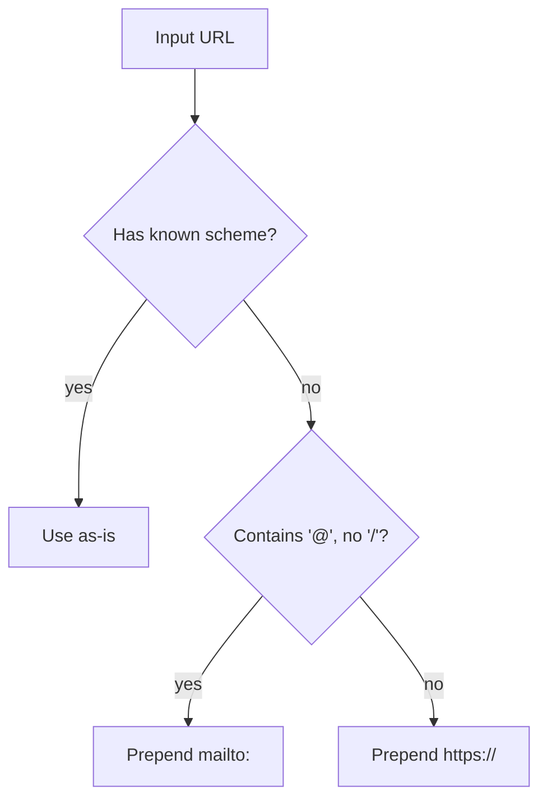

# Custom URL Slots

## Overview

A profile button does not have to wrap a Revit command. It can point at a URL, a `mailto:` address, or a local file path. This lets admins fold company resources — the BIM standards wiki, the SharePoint library, the helpdesk inbox — into the same ribbon people already use, without asking anyone to remember a separate set of bookmarks.

## Adding a link button

In the [Profile Builder](profile-builder.md), select the panel, then click **+ URL Button** under **Selected Panel**. Type a **Button label** (the text on the ribbon button) and the **URL**, then click **Add**; both are required. The link button is added to the end of the panel as a tool row whose id reads `URL:<link>`. Like any tool, you can rename it, give it an icon, and drag it to another place or panel.

On the ribbon the button's tooltip reads "Open: <link>".

## Supported link types

| Type | Example | How it opens |
|---|---|---|
| HTTPS URL | `https://bimstandards.example.com` | Default browser |
| HTTP URL | `http://intranet.local` | Default browser |
| Bare hostname | `bimstandards.example.com` | Default browser (normalised to `https://`) |
| Email address | `support@example.com` | Default mail client (normalised to `mailto:`) |
| `mailto:` link | `mailto:bim@example.com` | Default mail client |
| File path | `file://C:/Shared/Standards.pdf` | Default handler for that file type |
| `ftp://` URL | `ftp://files.example.com` | Default FTP handler |
| `tel:` link | `tel:+441234567890` | Default phone/dialler app |

## How the URL is opened

rst-c hands the resolved link to Windows via `ShellExecute` (the same mechanism Windows uses when you double-click a file or click a hyperlink). The operating system routes it to whichever application is registered as the default handler for that scheme or file type.

### Normalisation rules

The Builder lets admins type links in natural form. rst-c applies these rules when the button is added, and again when it is clicked:

Known schemes that pass through unchanged: `http://`, `https://`, `mailto:`, `ftp://`, `file://`, `tel:`.

A bare email like `support@example.com` becomes `mailto:support@example.com`. A bare hostname like `bimstandards.example.com` becomes `https://bimstandards.example.com`. Anything else with no recognised scheme also gets `https://` prepended.

> [!class2]
> Normalisation is deliberate and simple: rst-c does not check that the resulting URL resolves or that the target exists. The profile stores the normalised link.

## Notes & limits

- URL slots use the same button shape as command slots — they get a name, an icon, and a panel assignment in the Builder like any other tool.
- The Builder does not open links. The Live Preview shows the button; to test the link, load the profile and click the button on the ribbon.
- File paths in `file://` format must be absolute. Relative paths are not supported. UNC network paths (`\\server\share\…`) are not supported.
