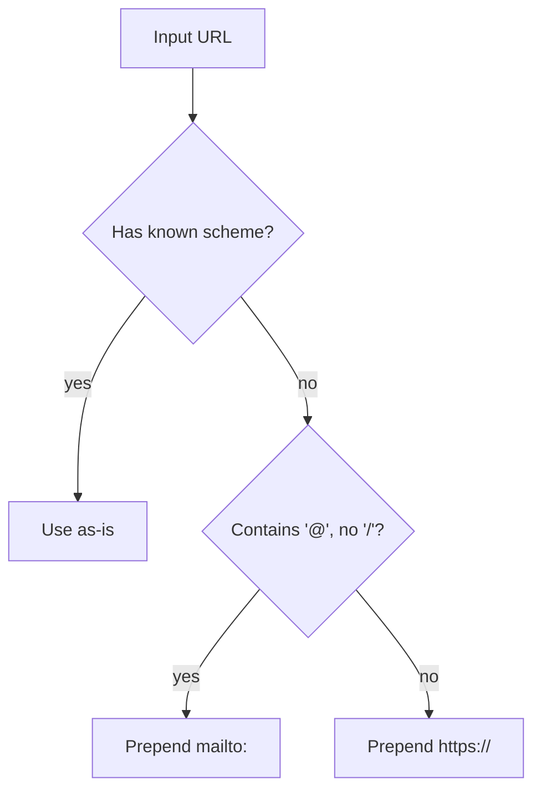

# Custom Tools

## Overview

A profile button does not have to wrap a Revit command. It can open a web page, start an email, or open a local file. This lets admins fold company resources (the BIM standards wiki, the SharePoint library, the helpdesk inbox) into the same ribbon people already use, without asking anyone to remember a separate set of bookmarks.

These link buttons are **Custom Tools**. The [Profile Builder](profile-builder.md) lists every one used in your profiles in a **Custom Tools** group at the top of its Commands pane, so a link made once can be placed in any profile, and fixed once when it moves.

## The Custom Tools list

The group sits first in the Commands pane, above the Revit command catalogue, with the note "URL and email tools found in your profiles. Drag onto a panel." Each row shows the tool's icon, its label and a kind tag: **EMAIL** for a `mailto:` link, **URL** for anything else. Hover a row (or move to it with the keyboard) for **✎** and **×**. Its tooltip shows the full link and "Used in: …", the profiles that hold it.

- **Where it comes from:** the list is not stored anywhere. It is built from every URL or email button in your saved profiles (`%AppData%\RST\profiles\`), plus the profile open in the Builder, unsaved edits included. Importing a profile adds its buttons to the list.
- **What makes two buttons one tool:** the link, after [normalisation](#normalisation-rules). Two buttons with the same link are the same tool, whatever their labels.
- **Label and icon:** taken from the first profile that holds the tool, by profile name.
- **When a tool leaves the list:** when no profile holds it any more. A tool on no panel of any profile is gone.
- **Placing it:** drag a row onto a panel, a tile or a stack, or double-click it to add it to the end of the selected panel. Each placement is a new button.
- **Keyboard:** ↓ in **Filter…** moves to the first row; ↑ ↓ move between rows; **Delete** removes the tool everywhere, after the same confirmation as **×**.

**Filter…** filters the Custom Tools as well as the catalogue; the group hides while none of its tools match.

## Creating a tool

Click **+ Create new** beside **Filter…**. **Create new tool** asks for:

- **URL** or **Email**;
- **Label** (required): the text on the ribbon button;
- **Address** (required), or **Email address** in Email mode, with a live "Opens: <link>" line showing exactly what the button will open;
- **Icon**: the icon picker, or none.

**Create** adds the button to the end of the selected panel, or the first panel if none is selected ("Added to "<panel>"."). A profile with no panels is refused with "Add a panel first." If the link is already in Custom Tools, the button is added anyway, as another placement of that tool ("That link is already in Custom Tools — another copy was added to the panel.").

In Email mode the address must be an email address (one, or several separated by commas, optionally followed by `?subject=…`); "That is not an email address. In Email mode, type an address such as bim@studio.example." refuses anything else.

The new button is part of the profile you are editing: save the profile to keep it.

## Editing a tool everywhere

**✎** on a Custom Tools row, or on a placed custom tool (a tile or a stack row), opens **Edit custom tool**, filled in. When it opens, nothing would change yet: the dialog reads "Nothing to change yet: edit the label, address or icon." and the button reads **Update**, disabled. As soon as your edit changes something, a warning names every profile that will change: "Changes apply everywhere this tool is used: <profiles>. Names and icons you gave it on a panel are kept." The button then reads **Update in N profiles**, N being the profiles that will actually change. While the label or address is missing or not valid, the button reads **Update**, stays disabled, and the reason shows.

When you confirm, in every saved profile that holds the tool, and in the profile open in the Builder:

- every button with the old link gets the new link and the new label as its base name;
- a button's **name** changes unless it was renamed on its panel, that is, unless it differs from the label the button was created with (its base name). A button with the same link but its own label in another profile was created with that label, so it takes the new label too;
- a button's **icon** changes only where it is still the icon the Custom Tools list shows for the tool, so an icon picked on a panel is kept;
- each changed file is validated and saved. Files the edit leaves as they are are not written.

The profile open in the Builder shows the change at once. Where its file was written, the change is already saved; your other unsaved edits stay unsaved. A profile that is open but has never been saved is listed as "(open, not saved yet)": the change shows in the Builder and is saved with the profile.

If the profile the Loader has loaded was changed, its ribbon tab is rebuilt when you close the Builder: the toast reads "Updated in N profiles. The ribbon updates when you close the Builder." Add-ins are never switched by this reload.

## Removing a tool everywhere

**×** on a Custom Tools row asks first: **Remove custom tool**, "Remove "<label>" (<address>) from every profile that uses it? A stack left with one tool becomes a plain button.", with the profiles listed and **Remove from N profiles** as the button. Every button with that link goes from every saved profile and from the open profile; if the loaded profile changed, its tab is rebuilt when you close the Builder.

**×** on a placed tile or stack row is different: it removes that one button from the open profile only, without asking.

## When a profile is not changed

An edit or remove never writes a file it cannot handle safely. These are listed under "Not changed:" in the dialog before you confirm, and reported again afterwards:

- a profile from an older version with no id: "a legacy profile with no id. Open it in the Builder and save it once.";
- two files that share one profile's id: "files share this profile's id. Remove the stale copy.";
- a file that could not be read, so it was not checked;
- during an edit, a profile whose buttons for the tool all carry their own names and icons, so the edit changes nothing there: "<name>: nothing to change there; its names and icons are its own." This is not a failure.

When every profile that holds the tool is refused, Edit reads "No profile can be changed." and its button stays disabled; Remove shows "No profile can be changed." instead of its confirmation.

If a file fails to save during the change, the others stay changed: **Some profiles were not changed** lists each one with the reason, and each failure is logged. Nothing is skipped silently.

The change reaches only the profiles saved on this computer for your Windows user. Copies already exported or shared with others are not changed.

## Supported link types

| Type | Example | How it opens |
|---|---|---|
| HTTPS URL | `https://bimstandards.example.com` | Default browser |
| HTTP URL | `http://intranet.local` | Default browser |
| Bare hostname | `bimstandards.example.com` | Default browser (normalised to `https://`) |
| Email address | `support@example.com` | Default mail client (normalised to `mailto:`) |
| `mailto:` link | `mailto:bim@example.com` | Default mail client |
| File path | `file://C:/Shared/Standards.pdf` | Default handler for that file type |
| `ftp://` URL | `ftp://files.example.com` | Default FTP handler |
| `tel:` link | `tel:+441234567890` | Default phone/dialler app |

**+ Create new** offers URL and Email. A `file://`, `ftp://` or `tel:` link typed in URL mode is kept as typed, and such buttons from existing profiles appear in Custom Tools as **URL** and can be edited like any other.

On the ribbon the button's tooltip reads "Open: <link>".

## How the link is opened

rst-c hands the resolved link to Windows via `ShellExecute` (the same mechanism Windows uses when you double-click a file or click a hyperlink). The operating system routes it to whichever application is registered as the default handler for that scheme or file type. Each click is logged (`SlotInvokeCommand: "Url" <link> (display=<label>)`).

### Normalisation rules

The Builder lets admins type links in natural form. rst-c applies these rules when the button is created or edited, and again when it is clicked:

Known schemes that pass through unchanged: `http://`, `https://`, `mailto:`, `ftp://`, `file://`, `tel:`.

A bare email like `support@example.com` becomes `mailto:support@example.com`. A bare hostname like `bimstandards.example.com` becomes `https://bimstandards.example.com`. Anything else with no recognised scheme also gets `https://` prepended. The scheme's case does not matter when two links are compared: `MAILTO:bim@example.com` and `bim@example.com` are one tool.

> [!class2]
> Normalisation is deliberate and simple: rst-c does not check that the resulting URL resolves or that the target exists. The profile stores the normalised link.

## Notes & limits

- In the profile file a custom tool is a tool slot whose `commandId` is `URL:` followed by the link. It gets a name, an icon and a panel like any other tool, and can sit in a [stack](profile-builder.md#stacks).
- The Builder does not open links. The Live Preview shows the button; to test the link, load the profile and click the button on the ribbon.
- File paths in `file://` format must be absolute. Relative paths are not supported. UNC network paths (`\\server\share\…`) are not supported.
- Two Revit sessions editing the same profiles: the last write wins. There is no locking.
