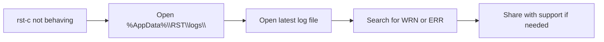

# Logging

[](https://md-converter.designs-os.com/?url=https://github.com/jedbjorn/rst-c/blob/main/docs/logging.md)

## Overview

rst-c writes plain-text logs through its own small logger (it ships no third-party logging library, so no other add-in's copy of one can interfere with it). The engine and rst-c's windows (the Loader, the Builder and Health) run in Revit's own process and write to the same session log, so a single file captures the full picture of a session when something goes wrong.

## Log location

Logs are written to:

```
%AppData%\RST\logs\
```

The directory is created on first launch. Each Revit launch writes two files that share a timestamp:

- `rst_<yyyy-MM-dd_HHmmss>_boot.log`: the bootstrap log (see [Bootstrap log](#bootstrap-log)).
- `rst_<yyyy-MM-dd_HHmmss>.log`: the session log, everything after the engine has loaded.

When Revit starts, rst-c keeps the 10 most recent `rst_*.log` files (about five sessions) and deletes older ones, so the directory does not grow without bound.

The RST tray app writes its own `tray_<yyyyMMdd>.log` files to the same folder and keeps its newest 10. Neither automatic clean-up deletes the other's files. Health's **RST Logs** clean-up, which you start yourself, clears both, except a log file that is open at the time. See [RST tray](tray.md).

The active log is the first place to look when a profile does not apply as expected, when the Loader shows an error, or when Revit exhibits unexpected behaviour after rst-c loads.

## Log content

### C# engine events

The engine logs at structured information and warning level throughout its lifecycle:

- **Bootstrap** — DLL resolution, engine load path, engine version, OnStartup result
- **Profile operations** — profile list reads, active profile reads and writes, profile apply, switch scheduling
- **Ribbon building** — tab creation, panel construction, slot registration, colour application, branding panel setup
- **RSTify** — tabs hidden and shown, icon update, profile switch tab-lift
- **Required add-ins** — scan results, auto-enable outcomes, missing add-in names
- **Health** — scan start, hardware readings collected, cleanup targets, files deleted and skipped
- **Errors** — exceptions are logged with full stack traces at Warning or Error level

### Window events

The Loader, the Builder and Health are native windows in the same process, so they log directly to the session log, interleaved with the engine's own lines. Each session of a window is bracketed (`=== Loader session opened: … ===` and `=== Loader session closed: duration=…ms ===`), and the window logs:

- **Opening:** what it read from Revit (for example `ProfileLoader ready: revit=2026, catalog=587 commands, tabs=16, …` or `Health window opening (owner Revit)`) and the Revit theme it opened in (`RevitThemeDetector`, at debug level).
- **User actions and their results:** loading, unloading, deleting and importing profiles (`UI: selector: Load attempt …`, `Loader.load_profile OK`), saving and exporting in the Builder (`Builder.save_profile OK: name=… → <file>`, `Builder.export_profile OK`), presets, cleanup targets and icon changes, scans and cleanups (`HealthCleaner.Run done`).
- **Failures:** every error the window shows you is also logged, with the exception's stack trace.

### Bootstrap log

Before the engine's logger starts, the bootstrap process (the thin `RST.Bootstrap` thunk that loads the engine from `%AppData%\RST\R<NN>\app\`) writes to a separate early-boot log at the same location. This log captures DLL resolution steps and is the first place to look if rst-c does not appear in Revit's ribbon at all. After the engine starts, it records `Third-party DLLs shipped: none (…)`: rst-c's app folder holds only rst-c's own DLLs. If that line is a `WRN` naming other files, they were added to the folder outside the installer (by hand, or by an older non-MSI install); delete them.

## Reading the log



Each entry is one line of plain text: the time, a three-letter level and the message, for example `05:38:01.133 INF Builder.save_profile OK: name=VM Test …`. The levels are `DBG`, `INF`, `WRN`, `ERR` and `FTL`; an exception's stack trace follows on the next lines. Searching for `WRN` or `ERR` is usually enough to find the relevant entry. The surrounding `INF` entries provide context (which profile was loading, which tab was being built) without needing to read the whole file.

## Notes & limits

- Log files are per-user, under `%AppData%\RST\logs\`. Each Windows user on the machine has their own log directory.
- Logs do not contain model content. They record rst-c's own operations only, which include file paths, profile names and the Windows user name; check a log before sharing it outside your organisation.
- Retention is by file count: the 10 most recent `rst_*.log` files are kept. If pruning ever fails (a locked file, for example), the Health tool's **RST Logs** cleanup target clears the folder.
- If the logs directory is missing entirely, rst-c failed to initialise its file sink. Check the bootstrap log path and verify that `%AppData%\RST\` is writable by the current user.
