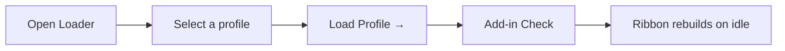

# Profile Loader

## Overview

The Loader is the end-user face of rst-c. It is a native Revit window that lists every profile installed for you, shows what is in each one before you commit, and loads the chosen profile onto the ribbon with one click. Most users only ever see this window: loading a profile is the whole job.

## Using it

### Opening the Loader

Click **Loader** on the **RST** panel of the **Add-Ins** tab. The window, titled **RST — Profile Loader**, opens centred over Revit:

- It belongs to Revit. It has no taskbar button of its own, and Revit waits until you close it.
- It uses Revit's light or dark theme, as set in Revit under Options → Colors → UI active theme (including "Use system setting"). The theme is read when the window opens; if you change Revit's theme, close and reopen the Loader to pick it up.
- **Escape** closes it, as **Close** does, except while a load or unload is running or a dialog is open over it.

### The window

- **Header:** "Profile Selector", the running Revit version, and **+ Import from File**. It has the same tinted header strip and pane headers as the [Profile Builder](profile-builder.md), so the two windows read as one family.
- **Profiles (left):** one card per profile, with its name, Tab, Min RST (the minimum RST version) and panel count, and a count of profiles at the top. The loaded profile has a green ring and a **● Loaded** badge. With no profiles installed, the list reads "No profiles found" and offers **+ Import Profile from File**.
- **Details (right):** the selected profile's name (with **● Loaded** when it is the loaded one), its Tab, Min RST and Updated date, and three sections:
  - **Tab Preview:** a read-only picture of the ribbon tab the profile builds: its panels, their colours and the tools' icons and names.
  - **RSTify: Hide These Tabs:** one switch per ribbon tab the profile can hide. See [Ribbon Tools](ribbon-tools.md).
  - **Required Add-ins for this profile:** each add-in the profile depends on, with its file name, an **info ↗** link where the profile has one, and a status pill for the running Revit year: **Native** (built into Revit), **Loaded** (installed and on), **Disabled** (switched off, by you in Autodesk's Add-Ins Manager or by rst-c; it does not load until switched back on), **Locked** (switched off by your administrator) or **Not Found**. A switched-off add-in never shows **Loaded**.
- **Footer:** **Unload Profile** and **Delete Profile** on the left; **Restore All Add-ins** and the **Disable unused add-ins** switch in the middle; **Load Profile →** and **Close** on the right.

### Browsing and previewing

Every profile stored under `%AppData%\RST\profiles\` has a card. Click a card to see its details; nothing changes on the ribbon until you click **Load Profile →**. When the Loader opens, the loaded profile is selected.

**Override Panel Opacity** (above the preview) sets how strongly this profile's panel colours are drawn for you, from 10 to 100. The preview follows the slider. Your value is saved for this profile when you let go of the slider, and it is used the next time the profile is loaded.

### Admin presets

A profile can carry defaults set by its admin on the [Builder](profile-builder.md#loader-defaults)'s **Loader defaults** tab: tabs to hide and whether to disable unused add-ins. The first time you select such a profile, the Loader asks **Adopt RSTify Presets?** and summarises the defaults. **Continue** turns them on; **Cancel** starts with nothing hidden and the switch off. Either way you are asked only once per profile, and you can change the switches at any time.

### Loading a profile

Select a card to enable **Load Profile →** and **Delete Profile** (both are disabled while the Loader is busy). Click **Load Profile →**. The Loader then:

1. Works out which add-ins to switch, in **every Revit year installed** on the computer (see [Ribbon Tools](ribbon-tools.md#how-add-ins-are-switched-on-and-off)). If there is an add-in to switch, shows **Confirm Add-in Changes** for **your Windows user, in each installed supported Revit year (2025–2027)**: **Will Be Switched Off**, **Will Be Switched Back On**, **Staying On (Required)**, and **Can't Be Changed** when something is locked by your administrator, one line per add-in with its years, for example "DiRoots.One (2026, 2027)". **Cancel** is the default button, so pressing Enter cancels. **Confirm & Load** goes ahead and runs exactly what the dialog showed. A plan containing only administrator-locked changes needs no confirmation. An unreadable settings file still prompts before a planned change is retried, because the retry may succeed.
2. Shows **Loading <profile>** while it works. The add-in changes run in the background, so the window stays responsive.
3. Shows the **Add-in Check** only when there is something to report: what was **Switched Off** and **Switched Back On**, what it **Could Not Change** and why (for example "Revizto (2027): locked on by your administrator"), the required add-ins that are **Missing — Not Installed** (each with a **download ↗** link or "(no link)") or **Required but Switched Off**, and any notes or failure to plan the changes. A shown report ends with "Add-in changes apply the next time Revit starts." Click **Continue**. When nothing changed or failed, there are no notes, and all required add-ins are installed and on, the report is skipped; the closing summary says "No add-in changes." Changes blocked by an administrator still appear in the report even when no confirmation was needed.
4. Shows a short summary for about 3 seconds, then closes: "Tab "<tab>" will be built.", a restart note when add-ins were changed, and a line for each required add-in that is not installed for this Revit version. A missing add-in never stops the load.

rst-c rebuilds the profile tab when Revit is next idle; no restart is needed. Your RSTify switches and the **Disable unused add-ins** setting are remembered for this profile in `%AppData%\RST\user_profile_prefs.json`. The loaded profile is recorded in `%AppData%\RST\active_profile.json` and loaded again automatically when Revit starts.

### Switching profiles

Open the Loader again, select another profile and click **Load Profile →**. rst-c removes the previous profile's tab and hidden-tab rules and builds the new one in a single pass. You do not need to close the model.

### Unloading

**Unload Profile** removes the loaded profile: "Unloading — A blank RST tab will replace the current one." shows for about 3 seconds and the window closes. With nothing loaded, it reports "No profile is currently loaded."

### Deleting a profile

Select the profile and click **Delete Profile**. The confirmation, **Delete "<profile>"?**, explains that this deletes your local copy and that the file shared by your admin is not affected. Its **Continue** button is red and **Cancel** is the default. Deleting the loaded profile unloads it first, then the window closes.

### Importing a profile

Click **+ Import from File** and choose a profile package (`.zip`) exported from the [Profile Builder](profile-builder.md). The profile appears as a new card. Importing a profile you already have replaces its card and refreshes its details. A file that is not a valid profile package shows **Import Failed** with the reason.

### Restoring add-ins

**Restore All Add-ins** switches back on every add-in rst-c switched off, in every installed Revit year, and shows the same report as a load: what was switched back on, what could not be and why, or "No add-in needed changing." Add-ins you switched off yourself in Autodesk's Add-Ins Manager (**Manage › Add-Ins Manager**) stay off: rst-c only undoes its own changes. The **Required Add-ins** pills update straight away. **Unload Profile** also switches back on what rst-c switched off, and shows the report when it did.

The first time the Loader opens after upgrading from RST 3.0, it moves the add-ins RST 3.0 switched off (by renaming their `.addin` files) into Revit's Add-Ins Manager settings and shows **Add-ins Switched Off by RST 3.0** once. Those add-ins stay off.

## How it works

The Loader is a WPF window inside Revit's own process. The **Loader** button reads what the window needs from Revit first (the ribbon's tabs and the running version) and reads the add-ins of every installed Revit year, then opens it owned by Revit's main window. Loading a profile hands the switch to Revit's next idle event, because Revit's ribbon can only be changed from Revit's own UI thread at a safe moment.

Profiles are read from `%AppData%\RST\profiles\`; the loaded profile and your per-profile choices are written under `%AppData%\RST\`. Everything is per-user, and no admin rights are needed.

## Notes & limits

- Profiles are per-user. Each Windows user has their own `%AppData%\RST\` folder and sees only their own profiles.
- Only one profile tab is active at a time. Loading a profile replaces the previous one.
- **info ↗** and **download ↗** open only `http://` and `https://` links, in your default browser. A profile shared with you is not trusted to open anything else, so other links are hidden (the Add-in Check shows "(no link)").
- Switching add-ins off and on takes effect the next time Revit starts. It goes through Revit's own Add-Ins Manager settings, per user, so it works for add-ins installed for all users too, without admin rights. Only add-ins your administrator locks can stop a change, and the report says which. Revit 2025 is partially supported: switching there needs Revit 2025.3 or later (Autodesk's Add-Ins Manager).
- rst-c never switches off RST itself, Revit's own add-ins, or add-ins published by Autodesk.
- Upgrading from v2.x: earlier versions kept a browser cache in `%LocalAppData%\RST\WebView2`. rst-c no longer uses it, and the installer and the add-in leave it in place; you can delete the folder.
- Profiles shared from another machine (via the Builder's **Export ZIP**) are imported here. See [Profile Builder](profile-builder.md).
