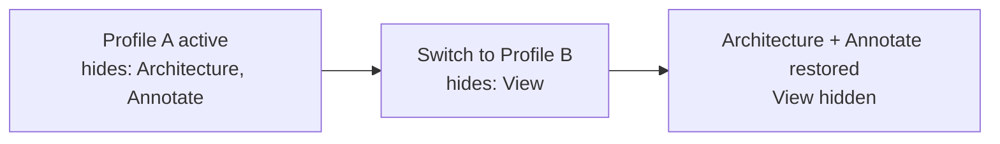

# Ribbon Tools

[](https://md-converter.designs-os.com/?url=https://github.com/jedbjorn/rst-c/blob/main/docs/ribbon-tools.md)

## Overview

Two ribbon-level tools come with every rst-c install: **RSTify**, which hides tabs the active profile does not use, and **Required Add-ins**, which checks and enforces the add-in dependencies a profile declares. Both are profile-aware and both are set up in the Loader. [Stacks](#stacks-on-the-ribbon) at the end of this page describes how a profile's stacked buttons are drawn on its tab.

## RSTify

### What it does

RSTify is a tab-hiding mode. When enabled, rst-c hides the Revit and add-in tabs chosen for the active profile. Only tabs the profile does not draw commands from can be hidden, so the profile's tab and the tabs its tools come from always stay. The ribbon narrows to just the tools the profile provides.

The intent is to remove the route back into the unfiltered Revit ribbon mid-session. A curated ribbon is only effective if users work from it — RSTify removes the distraction of the full tab bar while keeping the escape hatch (turning RSTify off) obvious and one click away.

The admin sets which tabs a profile hides by default in the Builder's RST Presets dialog:


### Turning RSTify on and off

The **RSTify** button is on the **RST** panel of the **Add-Ins** tab. The button icon shows the current state: tabs hidden (on) or tabs visible (off). Clicking it toggles the state and the icon updates immediately.

Which tabs are hidden is chosen per profile in the Loader: the **RSTify: Hide These Tabs** list has a switch for each tab the profile can hide. The core tabs (Modify, Manage, View, Annotate, Add-Ins, Create), the profile's own tab and the tabs its commands come from (the tools in its stacks included) are never listed. Your switches are applied when you click **Load Profile →** and remembered for that profile.

### How admin defaults work

The admin sets a list of tabs to hide, and the starting position of **Disable unused add-ins**, in the Builder's **RST Presets** dialog; they are stored in the profile's `presets` field. The first time a user selects the profile in the Loader, the Loader asks **Adopt RSTify Presets?** and summarises them. **Continue** adopts them; **Cancel** starts with no tabs hidden. Either way the question is asked only once per profile. From then on the user's own choices, stored per profile in `%AppData%\RST\user_profile_prefs.json`, apply on every load: the admin defaults only seed the first one.

### Switching profiles with RSTify active

When a profile is switched, rst-c lifts the previous profile's hidden tabs before applying the new profile's hide rules. A tab hidden by profile A is never left stranded-hidden when profile B is applied, even if profile B does not list that tab at all.



### What RSTify can and cannot hide

RSTify sets `IsVisible` on `Autodesk.Windows.RibbonTab` objects — the same property pyRevit's RSTify used. It can hide any tab that Revit's AdWindows layer exposes, including native Revit tabs and add-in tabs. The rst-c tab itself is never hidden.

> [!class4]
> AdWindows is an unsupported Autodesk API. It is de-facto stable across Revit versions but Autodesk does not guarantee backward compatibility. This is the same caveat pyRevit carried.

## Required add-ins

### What it does

A profile can declare the add-ins it depends on; the Builder works this list out from the commands used when the profile is saved. A command whose origin is unknown on one of Revit's own tabs (Architecture, Modify, …) is never recorded as an add-in, so built-in panel names such as "Build" or "Select" no longer appear in the list.

The Loader shows each required add-in's status for the running Revit year as soon as you select the profile:

| Pill | Meaning |
|---|---|
| **Native** | A built-in Revit tab: always available |
| **Loaded** | Installed and switched on (or, when no installed add-in matches, its tab is on the ribbon) |
| **Disabled** | Installed but switched off: in Autodesk's Add-Ins Manager, or by rst-c. It does not load until it is switched back on and Revit restarts |
| **Locked** | Your administrator has switched it off for this computer |
| **Not Found** | Not installed for this Revit year; the pill links to its download page when the profile has one |

A switched-off add-in never shows **Loaded**, even while its tab is still on the ribbon of the session you are in.

### How add-ins are switched on and off

rst-c switches add-ins through **Revit's own Add-Ins Manager** (Revit 2025.3 and later, 2026, 2027). Every Revit year keeps a per-user settings file, `%AppData%\Autodesk\Revit\Autodesk Revit <year>\AddinsData\AddInsSettings.json`, with an on/off entry per add-in. rst-c edits that entry, exactly as ticking or unticking the add-in in **Manage › Add-Ins Manager** would, and leaves every other entry and setting as it was.

- **For your Windows user only.** It works for add-ins installed for all users too, without admin rights, and other people on the same computer are not affected.
- **Every installed Revit year.** A switch applies to each Revit year installed on the computer, each with its own settings file.
- **At the next start.** Revit reads the file when it starts, so every change applies the next time that Revit year starts. rst-c can write it while Revit is running.
- **Revit 2025.0–2025.2** have no Add-Ins Manager. For those builds only, rst-c still renames the manifest (`X.addin` to `X.addin.RSTdisabled`), which works for add-ins installed for you; add-ins installed for all users need admin rights there.

rst-c keeps its own record of the add-ins **it** switched off, in `%AppData%\RST\addin_switches.json`. Switching back on only ever touches what is in that record: an add-in you switched off yourself in Autodesk's Add-Ins Manager stays off. An entry is cleared once the add-in is back on, or once it is no longer installed.

### When a profile is loaded

```linear
Plan :::class1 -> Confirm Add-in Changes :::class2 -> Switch (each installed year) :::class1 -> Add-in Check :::class3
```

The **Disable unused add-ins** switch decides the target:

| Disable unused add-ins | Required by the profile | Not required |
|---|---|---|
| On | On (switched back on if rst-c had switched it off) | Switched off |
| Off | On (switched back on if rst-c had switched it off) | Switched back on if rst-c had switched it off; otherwise unchanged |

Unloading a profile and **Restore All Add-ins** switch back on everything rst-c switched off, in every year.

Some add-ins are never switched off as "unused": RST itself, the add-ins inside Revit's own install folder, and add-ins published by Autodesk (Batch Print, eTransmit, …). You can still switch those yourself in Autodesk's Add-Ins Manager.

Before a load changes anything, **Confirm Add-in Changes** shows the plan per Revit year, one line per add-in with the years it applies to (for example "DiRoots.One (2026, 2027)"): what will be switched off, what will be switched back on, the required add-ins that stay on, and what is already known not to change (for example "Revizto (2027): locked on by your administrator"). **Cancel** is its default button. The load then runs exactly that plan.

### The Add-in Check

After every load, the **Add-in Check** reports what changed and what could not, with the year and the reason in plain words:

| Reason | What it means |
|---|---|
| locked on / locked off by your administrator | IT's `AdminSettings.json` decides this add-in; rst-c cannot change it |
| installed for all users; changing it needs administrator rights | Revit 2025.0–2025.2 only (the rename fallback) |
| a file was in use by another program; try again | Another program had the file open |
| no longer installed | The add-in was removed between the plan and the change |
| Revit's add-in settings file could not be read or written | rst-c never overwrites a file it cannot read; Revit rebuilds an unreadable file itself at its next start |

It also lists the required add-ins that are **Missing — Not Installed**, with a **download ↗** link where the profile has one (baked in from rst-c's curated registry when the profile is saved; only `http://` and `https://` links open), and those that are **Required but Switched Off**: switched off by you in Autodesk's Add-Ins Manager (turn them on there) or by your administrator. Every report ends with "Add-in changes apply the next time Revit starts." Unload and **Restore All Add-ins** show the same report. See [Profile Loader](profile-loader.md#loading-a-profile).

### How matching works

The status pills, Confirm Add-in Changes, the load and the Add-in Check all use one matcher, per Revit year:

```linear
Tier 1: the add-in's file name :::class1 -> Tier 2: its ClientId (AddInId) :::class2 -> Tier 3: fuzzy match of the tab name with the file name or the add-in's name :::class3
```

A tier that finds anything ends the search, and every add-in it matches counts. Tier 3 handles the common case where the installed file name differs from what the registry recorded (the registry says `Lumion.addin` but the install ships `LumionLiveSync.addin`).

rst-c finds add-ins where each Revit year loads them: your `%AppData%\Autodesk\Revit\Addins\<year>`, the machine-wide folder (`%ProgramData%\Autodesk\Revit\Addins\<year>` up to 2026; `C:\Program Files\Autodesk\Revit\Addins\<year>` from 2027), and the `ApplicationPlugins` bundles (yours, and `%ProgramData%` up to 2026 or `C:\Program Files\Autodesk\ApplicationPlugins` from 2027). A bundle's add-in counts only in the Revit years its `PackageContents.xml` names.

### Upgrading from v3.0

RST 3.0 switched add-ins off by renaming their manifests to `.addin.RSTdisabled`. The first time the Loader opens after the upgrade, rst-c moves each of those into Revit's settings file instead (the add-in stays off) and gives the file its own name back, and shows **Add-ins Switched Off by RST 3.0** once. A rename it cannot undo (an add-in installed for all users) is reported once and stays off. Revit 2025.0–2025.2 keep their renames.

## Stacks on the ribbon

A profile panel can hold [stacks](profile-builder.md#stacks): two or three small buttons, one above the other. In this version they are added by editing the profile's JSON; the Builder keeps them but does not author them yet.

- **How they look.** A stack is drawn like Revit's own stacked buttons: one small button per row, each with a 16 px icon (the tool's pack icon, decoded at 16 px, or rst-c's default icon, a dark ≡ on a light grey tile) and its label on one line. Large buttons keep their 32 px icon and two-line label. The panel's colour is drawn behind the whole panel, stacks included.
- **What they do.** A stacked button works like a large one: it runs its Revit or add-in command, or opens its URL.
- **When a stack is not drawn.** rst-c draws a stack only when it has two or three valid tools (each a tool with a command id). Otherwise the stack is skipped and the log (`%AppData%\RST\logs\`) records why, for example `stack 'Draw' has 1 valid item; a stack needs 2 or 3`. A tool slot without a command id is skipped the same way. A profile with such a stack fails validation when it is read, so it is not listed in the Loader or the Builder.
- **Switching and unloading.** Stacks are part of the profile tab, so a live profile switch or **Unload** removes them with the tab's other panels, and the next profile is built from scratch.
- **Required add-ins and RSTify.** Commands in stacks count towards the profile's required add-ins, and the tabs they come from are never offered for hiding.

Stacks are built through the same AdWindows interface as the rest of the profile tab (a row panel of small buttons), because Revit's own `AddStackedItems` only works while Revit starts, and profiles switch while Revit runs.

## Notes & limits

- Changing Revit's UI theme makes Revit rebuild its ribbon, and the hidden tabs come back until the next profile load.
- RSTify uses tab titles to identify tabs. Tabs with identical titles (rare but possible with some add-ins) will both be affected by a hide rule targeting that title.
- If Autodesk's Add-Ins Manager dialog is open and you press **Apply** after rst-c switched something, Revit's own choice wins; the next profile load applies the plan again.
- IT's admin locks (`AdminSettings.json`) are read, reported and respected, never changed.
- Saving the active profile in the Builder reloads its ribbon only; it never changes add-ins. Add-ins change through **Load Profile**, with its confirmation and its report.
- A profile's requirements are always evaluated against the computer it is loaded on, not the one it was built on. Profiles built before the required add-in feature (pre-RST-022) have an empty `requiredAddins` list; the check is a no-op for them.
