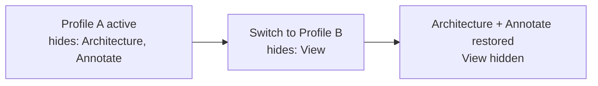

# Ribbon Tools

[](https://md-converter.designs-os.com/?url=https://github.com/jedbjorn/rst-c/blob/main/docs/ribbon-tools.md)

## Overview

Two ribbon-level tools come with every rst-c install: **RSTify**, which hides tabs the active profile does not use, and **Required Add-ins**, which checks and enforces the add-in dependencies a profile declares. Both are profile-aware and both are set up in the Loader. [Stacks](#stacks-on-the-ribbon) at the end of this page describes how a profile's stacked buttons are drawn on its tab.

## RSTify

### What it does

RSTify is a tab-hiding mode. When enabled, rst-c hides the Revit and add-in tabs chosen for the active profile. Only tabs the profile does not draw commands from can be hidden, so the profile's tab and the tabs its tools come from always stay. The ribbon narrows to just the tools the profile provides.

The intent is to remove the route back into the unfiltered Revit ribbon mid-session. A curated ribbon is only effective if users work from it — RSTify removes the distraction of the full tab bar while keeping the escape hatch (turning RSTify off) obvious and one click away.

The admin sets which tabs a profile hides by default in the Builder's RST Presets dialog:


### Turning RSTify on and off

The **RSTify** button is on the **RST** panel of the **Add-Ins** tab. The button icon shows the current state: tabs hidden (on) or tabs visible (off). Clicking it toggles the state and the icon updates immediately.

Which tabs are hidden is chosen per profile in the Loader: the **RSTify: Hide These Tabs** list has a switch for each tab the profile can hide. The core tabs (Modify, Manage, View, Annotate, Add-Ins, Create), the profile's own tab and the tabs its commands come from (the tools in its stacks included) are never listed. Your switches are applied when you click **Load Profile →** and remembered for that profile.

### How admin defaults work

The admin sets a list of tabs to hide, and the starting position of **Disable unused add-ins**, in the Builder's **RST Presets** dialog; they are stored in the profile's `presets` field. The first time a user selects the profile in the Loader, the Loader asks **Adopt RSTify Presets?** and summarises them. **Continue** adopts them; **Cancel** starts with no tabs hidden. Either way the question is asked only once per profile. From then on the user's own choices, stored per profile in `%AppData%\RST\user_profile_prefs.json`, apply on every load: the admin defaults only seed the first one.

### Switching profiles with RSTify active

When a profile is switched, rst-c lifts the previous profile's hidden tabs before applying the new profile's hide rules. A tab hidden by profile A is never left stranded-hidden when profile B is applied, even if profile B does not list that tab at all.



### What RSTify can and cannot hide

RSTify sets `IsVisible` on `Autodesk.Windows.RibbonTab` objects — the same property pyRevit's RSTify used. It can hide any tab that Revit's AdWindows layer exposes, including native Revit tabs and add-in tabs. The rst-c tab itself is never hidden.

> [!class4]
> AdWindows is an unsupported Autodesk API. It is de-facto stable across Revit versions but Autodesk does not guarantee backward compatibility. This is the same caveat pyRevit carried.

## Required add-ins

### What it does

A profile can declare the add-ins it depends on; the Builder works this list out from the commands used when the profile is saved. The Loader shows each one's status (Native, Loaded or Not Found) as soon as you select the profile. A required add-in that rst-c has disabled (renamed to `.addin.RSTdisabled`) shows **Not Found** here; when you load the profile, the Add-in Check re-enables it. When the profile is loaded, rst-c checks the machine against that list and takes one of three actions per entry, then shows the result in the **Add-in Check** dialog:

| Status | What happened | rst-c action |
|---|---|---|
| Installed and active | `.addin` manifest present, not disabled | No action needed |
| Installed but disabled | `.addin.RSTdisabled` found on disk | Auto-enables for next Revit launch |
| Not installed | No matching manifest | Surfaces a download link to the user |

### Auto-enabling disabled add-ins

When rst-c finds a required add-in that is disabled (its `.addin` manifest has been renamed to `.addin.RSTdisabled`), it renames it back to `.addin` and lists it under **Auto-Restored (Was Disabled)**. This takes effect on the next Revit launch: add-in DLLs already loaded in the current session do not hot-reload, so a restart is required, and the Add-in Check says so.

### Surfacing missing add-ins

When a required add-in is not found on the machine, the Add-in Check lists it under **Missing — Not Installed** with its name and, if the profile includes one, a **download ↗** link. The link is baked into the profile when it is saved, from a curated registry of add-ins in rst-c: if the registry knows the add-in's download page, the user gets a link; if not, the row reads "(no link)". Only `http://` and `https://` links open (in the default browser); anything else in a shared profile is treated as no link.

### Disabling unused add-ins

The Loader's **Disable unused add-ins** switch goes further: on load, every add-in the profile does not require is disabled by renaming its manifest to `.addin.RSTdisabled`, so it does not load next time Revit starts. Before anything is renamed, **Confirm Add-in Changes** lists what stays active, what will be disabled and what rst-c will try to disable; **Cancel** is its default button. **Restore All Add-ins** in the Loader renames every `.addin.RSTdisabled` back. See [Profile Loader](profile-loader.md#loading-a-profile).

### How matching works

rst-c matches required add-ins against the `.addin` manifests on disk using a three-tier policy:

```linear
Tier 1: match by addin filename (case-insensitive) :::class1 -> Tier 2: match by AddInId GUID :::class2 -> Tier 3: fuzzy match by ribbon tab title or display name :::class3
```

Tier 3 handles the common case where the installed `.addin` filename differs from what the builder's registry recorded (for example, the registry says `Lumion.addin` but the install ships `LumionLiveSync.addin`). The fuzzy match checks whether the live ribbon has a tab whose title contains the required add-in's tab name (or vice versa), and whether any manifest's display name or file stem is a substring match. This mirrors the logic the Loader's picker uses to decide whether an add-in shows as "Loaded", so the two views agree.

## Stacks on the ribbon

A profile panel can hold [stacks](profile-builder.md#stacks): two or three small buttons, one above the other. In this version they are added by editing the profile's JSON; the Builder keeps them but does not author them yet.

- **How they look.** A stack is drawn like Revit's own stacked buttons: one small button per row, each with a 16 px icon (the tool's pack icon, decoded at 16 px, or rst-c's default 16 px icon, a ≡ glyph) and its label on one line. Large buttons keep their 32 px icon and two-line label. The panel's colour is drawn behind the whole panel, stacks included.
- **What they do.** A stacked button works like a large one: it runs its Revit or add-in command, or opens its URL.
- **When a stack is not drawn.** rst-c draws a stack only when it has two or three valid tools (each a tool with a command id). Otherwise the stack is skipped and the log (`%AppData%\RST\logs\`) records why, for example `stack 'Draw' has 1 valid item; a stack needs 2 or 3`. A tool slot without a command id is skipped the same way. A profile with such a stack fails validation when it is read, so it is not listed in the Loader or the Builder.
- **Switching and unloading.** Stacks are part of the profile tab, so a live profile switch or **Unload** removes them with the tab's other panels, and the next profile is built from scratch.
- **Required add-ins and RSTify.** Commands in stacks count towards the profile's required add-ins, and the tabs they come from are never offered for hiding.

Stacks are built through the same AdWindows interface as the rest of the profile tab (a row panel of small buttons), because Revit's own `AddStackedItems` only works while Revit starts, and profiles switch while Revit runs.

## Notes & limits

- Changing Revit's UI theme makes Revit rebuild its ribbon, and the hidden tabs come back until the next profile load.
- RSTify uses tab titles to identify tabs. Tabs with identical titles (rare but possible with some add-ins) will both be affected by a hide rule targeting that title.
- Enabling or disabling an add-in requires write access to its add-in folder. Add-ins installed for all users (under `%ProgramData%`) usually need admin rights; where a rename fails, rst-c logs it and lists the add-in as not changed (for disables, under **Some Add-ins Were Not Disabled**).
- The Add-in Check and its auto-enable run when a profile is loaded. The status pills the Loader shows on selection only read the running session; they change nothing. A profile's requirements are always evaluated against the machine it is loaded on, not the machine it was built on.
- Profiles built before the required add-in feature (pre-RST-022) have an empty `requiredAddins` list; the check is a no-op for them.
